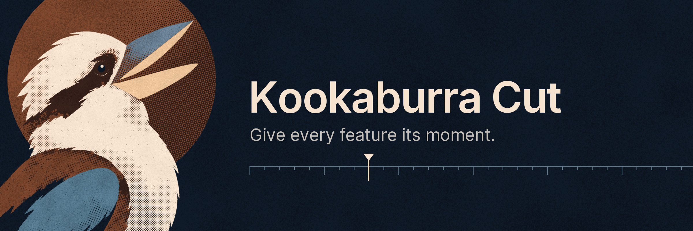
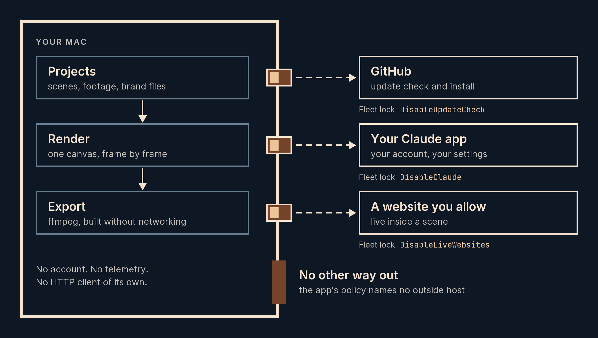

<h1 align="center">
  
</h1>

<p align="center">An AI driven, <strong>deterministic</strong> animated-video studio for macOS (Apple Silicon).</p>

<p align="center">
  <a href="https://github.com/michael-palmes/kookaburra-cut/actions/workflows/ci.yml"></a>
  <a href="https://github.com/michael-palmes/kookaburra-cut/actions/workflows/codeql.yml"></a>
  <a href="https://scorecard.dev/viewer/?uri=github.com/michael-palmes/kookaburra-cut"></a>
</p>

Kookaburra Cut renders every visual (animated text, graphics, and 3D) through a single
react-three-fiber WebGL canvas, and exports video by stepping a manual clock
frame-by-frame into a bundled **ffmpeg** sidecar (H.264 / H.265 / ProRes). It runs in
pure WKWebView via Tauri 2, no Chromium. Two exports of the same project are
byte-identical by design. Scenes can also be authored conversationally: Edit with
Claude hands your project to Claude Code, which reads and rewrites its scene files
while you watch them update here.

<p align="center">
  <a href="https://kookaburracut.com/">
    
  </a>
</p>

<p align="center"><sub>Reworking a device scene with Claude Code. More at <a href="https://kookaburracut.com/">kookaburracut.com</a>.</sub></p>

## Download

<p align="center">
  <a href="https://github.com/michael-palmes/kookaburra-cut/releases/latest">
    
  </a>
</p>

- A signed and notarised `.dmg`; macOS 26.0+ on **Apple Silicon** (arm64) only, no Intel build
- Free and open source. No accounts, no telemetry
- The optional AI authoring path uses your own Claude Code install
- Managed Macs install the signed `.pkg` through an MDM ([`docs/fleet.md`](docs/fleet.md))
- Accessibility: the WCAG 2.2 AA conformance report (VPAT), keyboard map and open findings are in [`docs/accessibility.md`](docs/accessibility.md)

## Secure and private

Built for Macs that hold unreleased work. Nothing leaves the Mac unless a person starts it.

<p align="center">
  
</p>

| Risk | Control |
| --- | --- |
| [Unreleased work leaves the Mac](SECURITY.md#what-leaves-the-mac) | No accounts, telemetry or crash reports, and no HTTP client of its own. Three paths reach the network: updates, Edit with Claude and a website you allow in a scene. A person starts each, and a fleet can force each off. |
| [The AI reads more than it should](SECURITY.md#what-reaches-your-agent) | The app holds no API key and never starts Claude. Edit with Claude opens one project folder in your own Claude install, which sends that project's files to Anthropic under your account and your organisation's Claude settings. |
| [A shared project or pack runs code](SECURITY.md#scene-code-and-the-trust-boundary) | Nothing runs on import. Scene code runs only after a person presses Allow, on a stage with no network and no app commands. Packs are signed and every file is hashed again as it lands. |
| [Text in a project gives the agent orders](SECURITY.md#what-reaches-your-agent) | What the agent reads from a project is escaped, capped and marked as data. Agent settings in a shared folder are moved aside, and a person sees the list before Claude starts. |
| [A tampered release or update](SECURITY.md#release-integrity) | Built by GitHub Actions from a signed tag with no signing secret in reach, signed behind a second reviewer, notarised by Apple and attested, with an SBOM. An update installs only with a valid signature from the key built into the app. |
| [Confidential files on the Mac](SECURITY.md#on-the-mac) | Projects stay in your home folder; nothing is uploaded or synchronised. App data is owner-only, sealed again at every launch and skipped by Spotlight. Encryption at rest is FileVault: the app adds none. |
| [Your organisation needs a ceiling](docs/mdm.md) | A configuration profile forces eleven keys. A person's own `defaults write` grants nothing, and a malformed key fails closed. |

**Not done yet:** one maintainer, no third-party penetration test, no SOC 2 or ISO 27001, no App Sandbox, and the agent is bounded by rules and prompts, not a sandbox. This is an early release in active development. [The full list](SECURITY.md#not-yet).

**Check it yourself:**

```bash
codesign -dvv "/Applications/Kookaburra Cut.app"         # Developer ID Application, hardened runtime
spctl -a -t exec -vv "/Applications/Kookaburra Cut.app"  # source=Notarized Developer ID
gh attestation verify KookaburraCut-<version>.dmg --repo michael-palmes/kookaburra-cut \
  --signer-workflow michael-palmes/kookaburra-cut/.github/workflows/release.yml \
  --source-ref refs/tags/v<version> --deny-self-hosted-runners  # built by this repository's release workflow at that tag
```

For your security team: [one page](docs/security-overview.md) · [threat model](SECURITY.md) · [managed Macs](docs/fleet.md) · [verify a release](docs/fleet.md#verify-a-release) · [privacy in plain words](docs/privacy.md) · [report privately](https://github.com/michael-palmes/kookaburra-cut/security/advisories/new)

## Core features

- **AI-authored scenes**: Edit with Claude opens the project in Claude Code, with
  a kit stamped into the folder. The output is plain, editable TSX built on a typed toolkit, not a
  black box.
- **Deterministic export**: a manual clock stepped frame-by-frame through one
  WebGL canvas into the ffmpeg sidecar. The same project produces the same
  bytes, every time.
- **Device mockups**: video and images play on a studio-lit 3D handset through
  a deterministic frame-extraction pipeline, with per-scene camera orbits.
- **Motion that looks finished**: headline presets, animated counters, a
  transition pack with live preview, LUT grades and film grain.
- **One project, every feed**: 16:9 / 9:16 / 1:1 / 4:5 from the same scenes,
  plus platform export presets (social, CTV, web, ProRes master) with size
  estimates and loudness targeting.
- **Projects are just files**: a folder of `project.json` + `scenes/*.tsx` +
  assets. Git-friendly, no opaque project format.
- **Themes**: JSON documents covering colour, typography, lighting, staging and
  text-motion defaults; swappable per project or per scene.
- **Fully local**: preview and export never leave your Mac.

## Building from source

Prerequisites:

- macOS on Apple Silicon, Xcode command-line tools (Xcode 26 to bundle the app or
  change its icon)
- Node 24.22.1, pnpm (`corepack enable` honours the pinned version)
- Rust through `rustup` (`rust-toolchain.toml` pins the version)
- ffmpeg on `PATH` (for the dev sidecar copy)

```bash
pnpm install
pnpm setup:ffmpeg     # provision the ffmpeg sidecar (dev copy of system ffmpeg)
pnpm tauri dev        # launch the app (Vite HMR + WKWebView shell)
```

Other commands:

```bash
pnpm build            # tsc --noEmit + vite build
pnpm test             # vitest
pnpm lint             # biome check .
```

Stack: Tauri 2 · React 19 · react-three-fiber · troika SDF text · anime.js v4 ·
zustand · ffmpeg/ffprobe sidecars. Package manager: **pnpm**. Full version list
in [`docs/architecture.md`](docs/architecture.md).

> Note: the photoreal device model is a licensed third-party asset and is
> **not** included in this repository (see Licensing below). Clones build and
> run against a bundled generic placeholder handset; dropping a licensed model
> into `src/assets/models/licensed/` overrides it (see
> `src/assets/models/README.md`).

## Layout

```
src/toolkit/   shipped authoring primitives  (the @kookaburra/toolkit surface)
src/engine/    timeline · format · compositor · exporter (deterministic loop)
src/theme/     theme schema, bundled themes, fonts
src/store/     zustand editor/preview state
projects/      one folder per project: project.json + scenes/ + assets/
src-tauri/     Rust shell, tauri.conf.json, capabilities/, bin/ (sidecars)
docs/          architecture, determinism, decisions, design, voice, privacy, security, fleet
.agents/       project skills (scene authoring, video editing, brand packs, release)
.claude/       slash commands (new-scene, preview, export); skills/ is a symlink to ../.agents/skills
```

## Authoring scenes

Scenes live in `projects/<project>/scenes/*.tsx` as `defineScene` default exports and
use `@kookaburra/toolkit` only: never the DOM or the wall clock. See the
`kookaburra-scene-authoring` skill and `/new-scene`, or
[`docs/determinism.md`](docs/determinism.md) for the why.

## Documentation

Start at [`docs/README.md`](docs/README.md). The short version:
[`docs/architecture.md`](docs/architecture.md) explains how rendering and export
work, [`docs/determinism.md`](docs/determinism.md) is the byte-identical-export
contract, and [`docs/decisions.md`](docs/decisions.md) records every locked
decision and why.

## Contributing

This is a personal, source-available project. Issues and discussion are welcome; pull requests may be declined: see [`CONTRIBUTING.md`](CONTRIBUTING.md). Report a vulnerability privately, as [`SECURITY.md`](SECURITY.md#reporting-a-vulnerability) sets out.

## Licensing

Kookaburra Cut's code is dual-licensed under either the
[MIT License](LICENSE-MIT) or the [Apache License 2.0](LICENSE-APACHE), at
your option. Bundled assets keep their own terms: fonts are OFL 1.1, HDRI
environments are CC0 (Poly Haven), and the photoreal device model is a
purchased licensed asset that is deliberately **not** in the repo (its
committed preview images are not reusable outside this project). The ffmpeg
sidecar the app drives is a **GPL** build (libx264/libx265), provisioned
locally by script and never committed here. Full inventory:
[NOTICE.md](NOTICE.md).

## Trademarks & affiliation

Kookaburra Cut is an independent project. Apple and iPhone are trademarks of
Apple Inc.; device names in the catalogue identify the hardware being
depicted. Platform names in export presets (Meta, TikTok, YouTube, LinkedIn,
X, Reddit, Telegram) identify export targets only. This project is not
affiliated with, sponsored by, or endorsed by Apple, OpenAI, Anthropic, or
any of those platforms.
