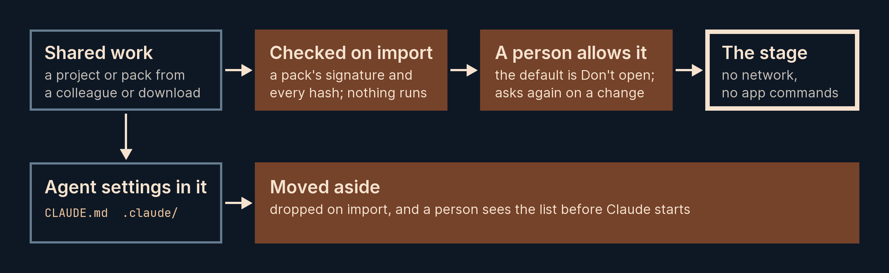

# Security policy

**As of version 0.25.0.** This file describes that version. Older versions
have less: 0.24.0 and 0.23.0 can open a website a person allows in a scene,
with `DisableLiveWebsites` and `AllowedWebsiteOrigins` as their locks, stamp
the agent kit and serve the bridge from the first launch unless
`DisableAgentKit` is forced, ignore `RequireManagedClaude`, and check GitHub
for updates from a pkg install unless `DisableUpdateCheck` is forced; 0.22.4
and 0.22.3 keep no log in a release build, share one website
store across projects, leave bridge requests unsigned, have no Allowed
projects list, Clear all app data, `AuditLogPath` or `AllowedWebsiteOrigins`,
and ship no pkg, SBOM or source archives; 0.22.2 has no managed keys for the agent
kit, pack export, exports in the project or the update endpoint; 0.22.1 asks
the Keychain for the pack key whenever Settings or Export opens, and its Later
stops the launch check offering that version again; 0.22.0 is 0.22.1 built
before the pinned toolchain and the whole-bundle record ("Release integrity");
and "Version 0.21.1" below lists what that version lacks.
Each release from 0.22.0 on carries its own copy of this file in its assets.

On a managed Mac, a configuration profile can pin the posture an organisation
needs: turn off the app's Claude launchers, its agent kit and bridge, pack
export or update checks, point update checks at the
organisation's own server, keep exports out of Downloads, limit pack imports to
approved publishers, and fix where projects are kept (`src-tauri/src/managed.rs`).
The app honours a key only while macOS reports it as forced by a profile, so a
user's own `defaults write` grants nothing, and a malformed key fails closed.
The keys and a sample profile: [`docs/mdm.md`](docs/mdm.md).

## Reporting a vulnerability

If you believe you have found a security issue (for example in the Tauri IPC
surface, the pack extractor, the bundled sidecar handling or the update
mechanism), report it privately through GitHub's
private vulnerability reporting: open the
[Security tab](https://github.com/michael-palmes/kookaburra-cut/security) and
choose **Report a vulnerability**, or use the
[report form](https://github.com/michael-palmes/kookaburra-cut/security/advisories/new)
directly, or email `security@kookaburracut.com`. A GitHub report creates a
draft advisory visible only to the maintainer, so details stay private until a
fix ships. Please do not open a public issue for
anything that looks like a security problem.

Include the app version (Settings ▸ About), your macOS version and steps to
reproduce. You will get an acknowledgement within 14 days, usually sooner, and
a fix or mitigation plan once the report is confirmed. Each fix is listed
under `### Security` in `CHANGELOG.md` and in the release notes built from it.

## Supported versions

0.23.0 is the first version recommended for managed Macs; earlier versions are
unsupported. Only the latest release receives security fixes. Older versions
are not patched; the in-app updater moves each Mac forward. Fixes are best
effort, with no committed time; please update before reporting. If a release
or a signing key is compromised: [docs/incident-response.md](docs/incident-response.md).

From 0.23.0 on, every security fix gets a GitHub security advisory beside its
`CHANGELOG.md` entry; the fixes in 0.23.0 itself are listed in the changelog
only. Stay informed: watch the repository's releases (Watch ▸ Custom ▸
Releases) and its [advisories](https://github.com/michael-palmes/kookaburra-cut/security/advisories).

## Version 0.21.1

0.21.1 was cut before most of what this file lists. On it:

- Pressing Allow runs a project's scenes in the main window, with that window's
  native commands, the terminal among them. Allow on a shared project runs code
  with your account, the same decision as running a program that person sent
  you. The sheet on that build says so.
- App data is not owner-only: `$APPDATA` is 0755, `settings.json` 0644 and
  `_bridge` 0755 with 0644 heartbeats, with no Spotlight or Time Machine markers.
- `asset://` serves every window `$APPDATA/cache` and the whole workspace.
- `CLAUDE_*` and `ANTHROPIC_*` reach every terminal, a scene's shell included.
- Footage and exports are not kept out of a project's git history.

Update once a newer release is out. Until then, open only projects and packs
you made, or that come from someone you'd run a program from.

## Scope and threat model

Kookaburra Cut is a local macOS desktop app that renders and exports product
films from a project folder of scene code, sidecars and assets, with an
optional Claude Code integration. It runs on corporate Macs holding
confidential, unreleased work. This file lists everything it touches and the
control behind each claim, at the version named on its first line.
[docs/privacy.md](docs/privacy.md) says the same in plain words.
Questionnaire answers (SIG Lite, CAIQ v4) are in
[docs/vendor-questionnaire.md](docs/vendor-questionnaire.md), and every third
party a Mac can reach in [docs/subprocessors.md](docs/subprocessors.md).

It is built for these risks:

- **A shared project or pack that carries code or agent configuration.** A
  project's scenes are TypeScript that the app compiles and runs; a pack or a
  shared folder can also carry `CLAUDE.md`, `.claude/settings.json`
  and a `.git` that names a program. Scene code runs only after a person presses
  Allow on a native sheet bound to the content's hash, and then on a stage shut
  off from the network and the app's commands; agent configuration is dropped on
  import and moved out of the folder at every open, and Claude won't start until
  a person has seen what moved; the agent's own git runs only where the app
  would run git itself; nothing in a pack runs when it is imported.
- **An agent that follows the wrong instructions.** Everything in a project
  (scene copy, `project.json` fields, brand files, notes, pack contents,
  captured frames, fetched pages) is written by whoever shared it. The stamped
  rules tell the agent it is data, never instructions, and every bridge and kb
  output escapes control, bidi and format characters and caps its length.
- **An agent that reaches too far.** The app starts no Claude Code, and no
  shell but the updater's administrator install ("On the Mac"): a session
  begins in the Claude app or the person's own terminal. kb
  writes only inside the project (any folder with a `project.json`, through
  `-C`), the workspace or a folder a person picked in the app this session, and
  refuses the credential folders it names, in any case; the whole workspace is
  routine to it, so it can reach another project without asking (see "Not
  yet"), and only bridge captures, frame ranges, checks, preset inserts and
  `openEdit` for another project ask in the app; commands that look like sending
  work off the Mac ask a person first. None of this is a sandbox (see "Not yet").
- **Confidential work on disk.** Projects, caches and exports stay in the
  user's home folder; nothing is uploaded or synchronised by the app. The
  app's own folders are owner-only (0700/0600), re-sealed at every launch and
  excluded from Spotlight; a deleted project's decoded frames leave the caches
  with it (below).
- **Other local users and a compromised window.** Each app window holds only
  the native commands it uses; a webview that is not one of the app's own
  windows gets none; the webview's content security policy names no outside
  host, and the app loads no web page.
- **A tampered install or release.** Releases are Developer ID signed with the
  hardened runtime and notarised; updates install only with a valid ed25519
  signature from the key baked into the app.

Out of scope: a hostile process already running as the same user can read the
user's files, settings and caches and drive the app itself; the controls here
make the app's own paths harder, not that one. Claude Code's own behaviour,
network use and storage (`~/.claude`) are Anthropic's, under the user's
account; the app bounds what it is given, not what it does.

## What leaves the Mac

Nothing leaves the Mac unless a person starts it. The app window's content
security policy (`src-tauri/tauri.conf.json`, `security.csp`), which the stage
worker inherits (Tauri sets the header on HTML only, so the worker starts from a
`blob:` URL: `src/stage/stageClient.ts`), allows `connect-src` only to itself,
`blob:`, `data:`, `ipc:` and `asset:`; no Rust code links
an HTTP client of its own (reqwest arrives only through the updater plugin, and
`src-tauri/deny.toml` bans it and the common HTTP client crates anywhere else);
the bridge is a file queue, not a socket
(`src-tauri/src/bridge.rs`); the release ffmpeg is built `--disable-network`
(`scripts/build-ffmpeg-sidecar.sh`). Opening a project, importing a pack,
exporting and presenting make no request, and allowed scene code can't make one:
a release build's worker refuses to start unless the policy is live
(`provePolicy`), and before any scene loads `src/stage/realmGuard.ts` limits
`fetch`, `WebSocket`, `XMLHttpRequest`, `EventSource` and `importScripts` to the
`asset:` paths its window handed over, `blob:`, `data:` and the app's own files,
and refuses every nested worker. The policy is the bound: code in the worker can
undo the guard (see "Not yet"). A dev build's worker (`pnpm tauri dev` and
terminal autoruns) starts without the policy, and its Vite server serves the
checkout only (`vite.config.ts`, `server.fs.allow`), never the home folder.

| Path | Trigger | Destination | Data | Consent and off switch | Control |
| --- | --- | --- | --- | --- | --- |
| Update check | Never on a copy installed from the release pkg, unless a profile turns it on (below). Otherwise at launch and hourly while the main window is open, at most every 20 h, only with the consent on and never during an export; or Check for Updates (menu, ⌘K, Settings), which runs without consent and stores nothing | `github.com/michael-palmes/kookaburra-cut/releases/latest/download/latest.json`, or the https URL a profile forces as `UpdateEndpoint` | One GET; no identifiers, no version in the URL; the plugin's user agent only | First-run welcome switch (on by default, Escape saves off); Settings ▸ Updates. `update_check_consent` in `$APPDATA/settings.json` | `src-tauri/src/updater.rs`, `src/engine/updates.ts`; `KOOKABURRA_UPDATE_ENDPOINT` is honoured only in debug builds; `managed::usable_endpoint` refuses an `UpdateEndpoint` with a query, fragment, login or `{{…}}` template, and an unusable one means no check, never GitHub |
| Update install | Install and relaunch on the update dialog; never on a copy installed from the release pkg, unless a profile turns it on | The release asset `latest.json` names | The signed updater archive | Later hides the offer until the next check | `updater.rs` (`download_and_install`); the ed25519 signature is checked against `plugins.updater.pubkey` before anything is written |
| Edit with Claude (`claude://` handoff) | Edit with Claude, once Claude is turned on and with the Claude desktop app installed | The Claude desktop app on this Mac, which talks to Anthropic under the user's account | The project folder path and a starter prompt, typed in, never sent | Leaving Claude off, or not pressing it; `DisableClaude` turns it off for a fleet | `src-tauri/src/claude_app.rs` (`code_session_link`, `open_in_claude`) |
| Fixed pages in the browser | Get Claude, or What leaves your Mac | `claude.ai/download`; `github.com/.../docs/privacy.md` at the installed version's tag (`main` in a dev build) | The constant URL, nothing appended | Not pressing it | `claude_app.rs` (`open_claude_download`, `open_privacy_page`, `privacy_url`) |

A copy installed from the release pkg leaves updates to its installer
(`package_install.rs`): `check_for_update`, `install_update_and_relaunch` and
`set_update_consent` refuse or record off, the Check for Updates menu item is
left out and Settings ▸ Updates shows one line in place of its switch and
Check now. The sign is the installer's receipt for the bundle id
(`/var/db/receipts/com.mpalmes.kookaburracut.plist`) naming the running
version, with the app running from `/Applications`; a receipt an older pkg
left under a newer copy from the DMG does not count, and a debug build never
does. A profile turns the in-app updater back on for such a copy by forcing
`UpdateEndpoint` (its own server) or `DisableUpdateCheck` to false (GitHub).
The receipt is root-owned and world-readable, and a person who can replace the
app with a DMG copy gets that copy's updater, which is the DMG's behaviour;
`DisableUpdateCheck` forced true is the control that holds either way.

Dev-time only, never in the app: `pnpm setup:models` downloads the beat model
from a pinned commit and checks its SHA-256 (`scripts/setup-models.sh`);
`pnpm setup:ffmpeg:release` fetches the ffmpeg, x264 and x265 sources against their pins (`scripts/build-ffmpeg-sidecar.sh`).

A configuration profile can force the update check, the Claude launchers and
the agent kit off, point the update check at the
organisation's own server, and keep a copy of the app log in a folder on the
Mac that the organisation's own collector reads (`AuditLogPath`; see "Managed
preferences").

## On the Mac

Every location the app writes, with its mode. `$APPDATA`, everything under
it, `_bridge` and `_autorun` are created 0700 (folders); files open inside them at the umask
unless written through `privacy::atomic_write_private` (0600 from the first byte),
every launch re-seals the trees to 0700/0600 in the background and logs one `[privacy]`
line when it had to correct anything, and `cache/`, `logs/`, `_bridge/` and
`_autorun/` carry `.metadata_never_index` (`src-tauri/src/privacy.rs`, `audit.rs`;
`scripts/kookaburra-run.sh` seals the queue it creates). A workspace folder
the app creates itself is 0700, so other accounts on the Mac can't list or read
its projects; a folder that already exists keeps its mode and is never changed
(`workspace::ensure_root`). Inside it, projects and the workspace folders are
the user's documents and take the umask default; pack extraction forces
0644/0755 on what it lands. `cache/clips` and
`cache/media` carry Time Machine's per-item exclusion attribute
(`com.apple.metadata:com_apple_backup_excludeItem`, set at every launch by
`privacy::exclude_from_backup`), so what those two caches hold never reaches a
backup. Everything else is backed up like any document: projects with their own
`assets/`, the frames kb keeps in `.kb/` and `<film>.flashes/`, capture PNGs in
`_bridge/responses/`, and the other caches under `$APPDATA/cache`. `$APPDATA` is
`~/Library/Application Support/com.mpalmes.kookaburracut` (`src-tauri/src/tools.rs`).

- **The workspace, `~/Kookaburra Cut`** by default (`WORKSPACE_DIR_NAME` in
  `src-tauri/src/workspace.rs`; Settings ▸ Workspace moves it through
  `move_workspace`, settings window only, behind a native sheet, refused during
  an export or import; `KOOKABURRA_WORKSPACE_ROOT` overrides it for one boot).
  One folder per project: `project.json`, `scenes/`, `assets/` (with
  `.originals/` for conformed footage, `_meta.json`
  provenance holding bare file names only), `edits/`, `exports/`, a per-project
  git repository (`create_project` runs `git init` with `/assets/` and
  `/exports/` in `.git/info/exclude` before its one commit, so footage and
  renders never enter history and a trashed asset is gone; a project from
  before this rule has them rewritten out of its history, reflog expired and
  pruned, on its next open, off the load path, with one toast and one
  `[history]` log line, only when the app made the repository: one with a
  remote, a root commit by someone else, a `.git` file or a link anywhere in
  `.git` is left as it is and logged, and the trim prunes objects only, never
  worktree records: `src-tauri/src/history.rs`), `CLAUDE.md`,
  `NOTES.md`, `BRAND.md`, the stamped `.claude/` and `./kb`, anything a stamp
  moved out of the way (`kb.moved-aside`, `.claude.moved-aside*`),
  `.kookaburra/app-edits.jsonl` (what the app's own writers changed, for the
  agent: `src-tauri/src/app_edits.rs`), `.kb/` and, beside
  a film, `<film>.flashes/` (the frames of its flash warnings). `.kb/` ignores
  itself in git, never travels in a pack, and holds the agent's lock, leases,
  events and notes, kit files someone edited (`kit-replaced/`, kept before a
  restamp), plus work that can show confidential content: `captures/`,
  `previews/`, `flashes/`, `footage/`, `thumbs/`, `song/` (a track's analysis) and
  `reference/` (frames of a reference film and the words read from them).
  Workspace-level: `brands/`, `themes/`,
  `fonts/`, `gradients/`, `export-presets/`, `presets/`, `templates/`,
  `objects/`, `screenshots/`, and `.kookaburra/` (welcome snapshots and scene
  thumbs per project, pack import staging, and `import-backup/` holding what an
  import replaced, hard-deleted after 24 h). Files reach the webview as
  `asset://` URLs served by the app's own handler (`src-tauri/src/asset_reach.rs`,
  registered in place of Tauri's): an app window may read `$APPDATA/cache`,
  `fonts/`, `objects/` and the one project it loaded last
  (`read_project_manifest`), which it loses on the welcome screen
  (`release_project`) or when the window closes; only the main window also reads
  `templates/`, `presets/`, `brands/`, `screenshots/` and the snapshots and scene
  thumbs under `.kookaburra/`; any other webview is served
  nothing. The stage worker's own guard (`realmGuard.ts`) narrows that list for
  code that leaves it alone, but code inside the worker can undo it, so the
  window's list is the bound (see "Not yet"). Paths are canonicalised before the
  check and must stay below the root the request names, so a link inside a
  project that leads out of it is refused, even into another folder the window
  may read, and no hidden folder below a root is served (`.emoji-cache`
  reads through a command). Native reads of a project asset go through
  `media::resolve_asset_in`, which refuses the same links by name, and
  `copy_dir_recursive` refuses to copy a link at all.
- **`~/Kookaburra Cut/_bridge/`** (always under the home folder, even when the
  workspace moves): the agent bridge's file queue. `responses/` holds answers
  cleaned through `clean_text`, capture PNGs, contact sheets and export
  progress for up to an hour and 2 GiB in all; `requests/.claimed/` the claimed
  requests; `apps/<pid>.json` and `app.json` heartbeats carry the executable
  path, workspace root, open project, playhead and the folders picked this
  session; `cli.json` the headless CLI's location; `keys/<pid>.key` each
  serving instance's bridge key (folder 0700, file 0600, removed on exit and
  pruned with dead heartbeats). kb also writes there:
  `exports/<slug>/` (one record per finished `kb export`, the newest 50 kept),
  `film/<slug>/` (frames and sheets of its film runs, the newest 12 kept),
  `video/<slug>/` (`kb video` scratch, pruned to three drafts per edit, 24 h and
  1 GB) and `font-verdicts.json` (the app's font verdicts, cached); see
  `docs/agent-kit.md`. The app never creates it
  under `DisableAgentKit` (`bridge_root` refuses first), though kb in a kit
  stamped earlier can still write requests nobody answers. Control: `bridge.rs`
  (`bridge_root`, the caps at its head, `prune`), `bridge_auth.rs`.
- **`~/Kookaburra Cut/_autorun/`**: terminal-triggered runs (`runs/<id>/` with
  `last-run.json`, `dev.log`, screenshots and preview batches), the gate cache
  and the FIFO queue. Control: `scripts/kookaburra-run.sh`, `scripts/ready.mjs`,
  `autorun_result_dir` in `lib.rs`.
- **`$APPDATA/settings.json`**: preferences, `updateCheckConsent` and the
  update bookkeeping, `trustedProjects` (slug, path, content hash, time),
  `knownPublishers` (the TOFU store),
  `agentFiles` (per folder, what a stamp moved and whether a person has seen it),
  the publisher profile and the Claude preferences; per-project entries other
  than the trust grant and `agentFiles` outlive a project delete. Settings ▸ Allowed projects
  lists `trustedProjects` and forgets one grant, stored and session alike
  (`forget_allowed_project` in `settings_win.rs`,
  settings window only, through `forget_project_trust`). Written through a temporary file that is 0600 from its first byte, then
  a rename, under one lock. Control: `workspace.rs` (`AppSettings`,
  `settings_path`), `privacy::atomic_write_private`.
- **The pack signing key**: 32 raw bytes created on the first pack export, a
  generic password in the login Keychain (service "Kookaburra Cut pack signing
  key", account the bundle identifier, `kSecAttrSynchronizable` unset so it
  never leaves the Mac); macOS may ask once whether the app may use it, only
  when signing or rotating, and a declined prompt stops that rather than
  minting a second key. `$APPDATA/pack-key/ed25519.key` (folder 0700, file
  0600, refused if group or other bits are set) is the fallback only where the
  Keychain cannot answer: no login keychain, or `KOOKABURRA_PACK_KEY_FILE=1`;
  a file from an earlier build moves into the Keychain at the next signing and
  is deleted. Settings reads only `pack-key/identity.json` (0600, atomic): the
  public key, its id and where it lives, rewritten at signing whenever it
  disagrees with the real key. Builds without a Developer ID signature, and
  autoruns, never touch the Keychain and keep their own file key in
  `$APPDATA/pack-key-dev/`, so a dev or ad-hoc build can't create the release
  item with an access list that trusts only itself. Control:
  `src-tauri/src/pack/key.rs`.
- **`$APPDATA/cache/`**: `clips/` (decoded video frames per content hash,
  capped at 20 GB by default with least-recently-used eviction in 120-frame
  chunks, never while pinned by an open project or a running export; an
  extraction is refused up front when its raw-frame ceiling would leave the
  volume under 2 GB, naming the space it needs; Settings
  ▸ Storage sets the cap and clears it; deleting a project or an asset drops
  its entries, except content another project, template or preset still maps
  to), `media/` (posters, scrub frames and probe data by content hash, brand
  images and screenshots included; Settings ▸ Storage clears it, and a project
  or asset delete drops its entries and path stamps),
  `theme-previews/`, `beats/` (song analysis, which can include a track's lyric
  tags), `loudness/`, `font-embedding.json`, `tapdot/` and `export-mezz/` (the
  two-pass mezzanine, removed when the export ends). Settings ▸ Storage ▸
  Clear all app data (`clear_app_data` in `settings_win.rs`, settings window
  only) asks on a native sheet whose Return is Cancel and is refused while an
  export, a pack import, an editor render or another terminal run is going.
  It clears `clips/` and `media/` through their own clears, every other entry
  of `cache/` but its Spotlight marker,
  `_bridge/responses`, `requests` and `apps`, `_autorun/runs` and
  `.window-state.json`; drops every session grant (Allow,
  bridge projects); resets `settings.json` to the workspace location and
  `updateCheckConsent` (`reset_settings` in `workspace.rs`); and re-seals the
  cache roots (`privacy::seal_cache_roots`). `pack-key/`, `pack-key-dev/`, the
  Keychain item, `logs/`, the projects and the workspace stay. Control:
  `src-tauri/src/clip_cache.rs`, `media.rs`,
  `theme.rs`, `song/mod.rs`, `loudness.rs`, `fonts.rs`, `edit.rs`, `lib.rs`.
- **`$APPDATA/.window-state.json`**: window positions (`tauri-plugin-window-state`),
  written again at quit, so a clear resets them only for that launch's windows.
  The webview's `localStorage` holds font, colour and icon recents and UI
  toggles, nothing from a project's content; the settings window empties it
  when Clear all app data finishes (`src/settings/SettingsApp.tsx`).
- **`$APPDATA/logs/`**: `app.log`, the app's own record, kept by release and
  dev builds alike (`src-tauri/src/audit.rs`, `audit::builder`): what a stamp
  moved or stripped and where the agent's git is off (`[kit]`), footage trims
  (`[history]`), Allow given, declined, asked again and forgotten (`[trust]`),
  the removal of what live websites left (`[website]`), pack imports with the
  publisher's key id, verdict, item counts and outcome, and each pack export
  with its item count, key id and file (`[pack]`), each Edit with Claude
  handoff with the project's folder (`[claude]`), each finished video or stills
  export with its kind, aspect, format and file (`[export]`), update checks
  and installs (`[update]`), workspace moves and project deletes
  (`[workspace]`), Clear all app data (`[settings]`), managed keys and each key's first refusal a launch (`[managed]`) and what the startup
  seal corrected (`[privacy]`). Lines hold paths, slugs, key ids,
  versions and counts, never a file's contents or a secret, and a name a pack or
  project chose is escaped onto one line (`audit::field`). Each line is
  `[<ISO 8601 UTC time>][<module>][<LEVEL>] <message>`, and the formatter
  escapes every control character in the whole message, so no file or folder
  name can start a line of its own (`audit::line`). Only the app's own lines
  reach it, never the webview's or a library's (`own_target`). A file rotates
  at 1 MiB and three are kept, at most 3 MiB (`ROTATED_KEPT`); the folder is
  made 0700 with `.metadata_never_index` before the first line (`log_dir`), a
  file opens at the umask inside it, and every launch re-seals the files to 0600
  (`privacy::seal_at_startup`). The app never sends it anywhere, and no managed
  key turns it off (`docs/decisions.md`, "Release builds keep a log"). Settings ▸
  About ▸ Export log writes the files end to end, oldest first, as one 0600
  `.log` where the person chooses in a Save panel Rust opens itself, never
  through a link and never inside `$APPDATA` (`audit::export_app_log`). Under
  `AuditLogPath` every line also goes to `<folder>/<login>.log` for the
  organisation's collector (`src-tauri/src/audit_mirror.rs`): the folder must be
  absolute and outside every home folder, the file opens without following a
  link or blocking on a FIFO and is used only when this account owns it alone
  with one link, held 0600 and rotated like `app.log`, and anything wrong stops
  the copy, never the app or the local log. The headless CLI kb runs never
  starts it and writes to stderr (`src-tauri/src/main.rs`).
- **What live websites left**: 0.24.0 and earlier kept one WebKit data store
  per project for the websites a scene could open, and their origin grants in
  `settings.json`. The app opens no website now, and at each launch it lists
  every data store it made (`WKWebsiteDataStore.fetchAllDataStoreIdentifiers`;
  its own windows use WebKit's default store, which is not on that list),
  removes each one and drops `websiteOriginGrants` from `settings.json`,
  logged `[website]`. A settings file the app can't read is left alone.
  Control: `retired_websites.rs` (`clear_at_launch`), `workspace.rs`
  (`drop_website_grants`).
- **Exports**: `~/Downloads/<project>-<aspect>.<ext>` by default, never
  overwriting, or the project's `exports/` folder (Settings ▸ Video, "Save
  exports to Downloads"; terminal and bridge runs always use the project
  folder, and so does every export under `ExportsInProject`, which routes a
  Downloads request to the project in `export_dir_kind`). Video and stills
  follow the same rule. ffmpeg writes a hidden `.part` sibling and renames it
  on success. A video export that fails leaves `<export>.health.json` where
  the film would land in the project's `exports/`: the reason and error, the
  frame and scenes it reached, its render rate and the app's memory samples
  (`export_health.rs`, `health_path`); the next start of that export, or its
  success, removes it. `.kbpack` files go where the Save
  dialog `build_pack` runs from Rust points, never a webview path
  (`pack::commands::validate_destination` refuses system folders, `$APPDATA`
  and the app bundle). Control: `resolve_export_output` in `lib.rs`.
- **`~/.claude`**: Claude Code's own history, sessions and login. The app never
  reads or writes it; the only agent files it writes are inside the project
  (`kit.rs`).
- **Temporary files**: hidden siblings beside their target (`*.tmp`,
  `.staging-*`, `.part`, `.kit-tmp`, `.kc-render/`); the app has no
  `std::env::temp_dir` outside tests. The updater plugin unpacks an update in
  the system temporary folder while installing, or beside the app when that
  folder is on another volume. kb and the brand skill use it for
  short-lived work that can hold copies of stills and frames (`kb-*` and `brand-*`
  folders, removed when the step ends), and for hook baselines (`kb-hooks/`).

Deletions go to the Trash through `workspace::trash_path` (NSFileManager):
projects, scene files, media and their originals, themes, gradients, export
presets, screenshots, user templates and scene presets. Import backups after
24 h (both import screens say so) and cache clears delete in place. A project
delete removes its trust grant and its clip and media cache entries (the media is hashed before
the folder moves, from the library's stamps where it has them), and nothing
from the snapshots or thumbs.

Processes the app starts: the ffmpeg and ffprobe sidecars are spawned from
Rust by basename with argv built from typed structs, never a shell
(`src-tauri/src/lib.rs`, `encode.rs`, `media.rs`), with `env_clear()` plus
`HOME`, `PATH`, `TMPDIR`, `LANG`, `USER` and `LC_*` (`tools::sidecar`,
`tools::sidecar_command`). Every ffmpeg lane whose stdin is not the frame pipe
passes `-nostdin`. Each lane that opens project, library or pack bytes takes its
input arguments from `src-tauri/src/media_input.rs`: `-protocol_whitelist
file,pipe` and format and codec whitelists, so a playlist or concat file can't
pull in another file on the disk and ffmpeg reaches only the demuxers and decoders
the app supports (kb's lanes use `kblib/media_input.py`, and a test fails on one
that skips it). The export soundtrack must
be an absolute file with an audio extension inside the readable roots
(`media::confine_soundtrack`), and preset `profile`, `level` and `entropy`
are allow-listed in both languages (`encode.rs` `EncodeSpec::validate`,
`src/export/presetSchema.ts`).

Also:

- `git` from `PATH` (`history.rs`), at project creation and after a project has
  loaded through the Allow gate, never on a failed load, to find footage in older
  history and rewrite it, at each kit stamp to read `.git/config` for the
  agent's verdict, and before each Edit with Claude handoff to check the
  committed agent files ("What reaches your agent"). When `git` is Apple's
  `/usr/bin/git` shim, `xcode-select -p` runs before the launch's first git
  run, once, to check the developer tools are there (`git_usable`). A folder's `.git` arrives with it, so each run sets
  `GIT_CONFIG_NOSYSTEM`, `GIT_CONFIG_GLOBAL=/dev/null` and `GIT_CEILING_DIRECTORIES`
  and overrides every key that names a program (`GUARDS`), and the app refuses a
  `.git` that is a link or file, holds a link (outside its hooks, which never
  run), or a `.git/config` holding a key the app and git's own setup don't write. kb's git does the same (`kblib/git.py`). The
  agent's own plain git has no such overrides, so it gets the same verdict and a
  hook check instead (`history::agent_git_verdict`, "What the kit auto-allows").
- `/usr/bin/sips` to check and convert a dropped still (`src-tauri/src/imagefile.rs`,
  `kblib/imagefile.py`): one file, a 60 s limit in the app, no shell, and the
  app's own environment, not the sidecars' allow-list. kb and the brand skill also
  run `osascript` to rasterise an SVG they have rewritten first (`kblib/svgsafe.py`).
- `open` for Finder, the `claude://` handoff and the fixed pages (`claude_app.rs`).
- The updater, only after Install and relaunch (`updater.rs`,
  `download_and_install`): `touch` from `PATH` on the installed bundle, then
  `/usr/bin/open -n` to relaunch it (Tauri's `restart`). When the app's folder
  isn't writable, macOS asks for an administrator password and the plugin runs
  `do shell script` as root: `sh` with `/usr/bin/osascript -l JavaScript` to
  swap the bundles, then `mv` and `rm` on paths it quoted itself. Cancelling
  leaves the installed app as it was.

The app never starts Claude Code, and starts a shell only for that administrator
install.

## What reaches your agent

Claude Code runs outside the app, in the Claude desktop app or the person's own
terminal, under their own account, install and settings. The app holds no API
key, sends nothing to Anthropic itself and starts no Claude Code, and no shell
but the updater's administrator install, so no credential passes through it and
no window can type into a session.

Everything below is off until a person turns Claude on. One gate
(`agent_gate.rs`, `deny`) stands in front of all of it: a profile forcing
`DisableAgentKit` shuts it first, and after that it opens only on a stored
answer of yes (`claudeConsent` in `settings.json`), given on the first-launch
ask or in Settings ▸ Claude and changed there at any time. No answer counts as
off, and so does a dismissed ask. While the gate is shut no kit is stamped or
healed (`stamp_claude_provisioning` and `heal_project_kit` in `workspace.rs`),
a pack import keeps no default `CLAUDE.md` (`pack/commands.rs`, `apply_import`),
the bridge never serves and the app never creates `_bridge` (`bridge_root`,
`serving`), no heartbeat is written, the handoff and the Claude download page
refuse (`open_in_claude`, `open_claude_download`), and every Claude entry point
is hidden. The gate is read live: turning Claude on in a running app draws the
bridge key and starts the heartbeat without a relaunch, and turning it off
removes this instance's heartbeat and key within one refresh (`bridge.rs`,
`apply_gate`). `set_claude_consent` records off whatever it is asked while a
profile forces `DisableClaude` or `DisableAgentKit`, and each change is one
`[claude]` line in the log. A profile forcing `RequireManagedClaude` adds one
condition between the two: the gate also stays shut unless Claude Code's own
managed policy pins sign-in to an organisation on this Mac, read from
`forceLoginOrgUUID` (a non-empty string or list) in
`/Library/Application Support/ClaudeCode/managed-settings.json`, any `*.json`
in `managed-settings.d/` beside it, or the key forced in the
`com.anthropic.claudecode` preference domain (`claude_policy.rs`,
`org_pinned_in`). A file counts only when root owns it and neither group nor
others can write it (`root_owned`), since the admin group can write
`/Library/Application Support`; the key checks that sign-in is pinned, not to
which organisation. A file that is unreadable, over 1 MiB or not JSON counts as
missing; the answer is cached for a minute and read afresh before each handoff
and each use of the switch. It proves the policy is installed, not that a
session obeys it, and it cannot see settings an organisation delivers only
from the claude.ai admin console. Settings ▸ Clear all app data forgets the answer,
so Claude is off until it is asked for again. A kit stamped before Claude was
turned off, or before a profile, stays in its folder, and its kb still runs:
the gate governs what the app lays out, not a Claude Code session a person
starts in a terminal. A debug build takes `KOOKABURRA_CLAUDE=1` as the answer,
for throwaway-home test runs; a release build never reads it.

- **The `claude://` handoff** (`claude_app.rs`): `open claude://code/new?folder=<project>&q=<prompt>`,
  the prompt capped at the Claude app's limit, opened only when LaunchServices
  reports a handler; the prompt is typed into the app, not sent, until the
  person presses Enter there. The `folder` and `q` parameters of that link are
  not in Claude's public documentation (it documents `ssh_folder` only), so
  the handoff rests on behaviour Anthropic could change without notice; if it
  did, the link would open the Claude app without the folder or the prompt,
  and nothing would be sent. The kit is stamped first, and if the stamp moved
  files aside a native sheet lists them before the handoff
  (`review_agent_files_for`); then the project's git history is checked too
  (`review_committed_agent_files`, below). The launcher's copy says "Claude Code sends this
  project's files to Anthropic under your own account and settings."
  (`CLAUDE_DISCLOSURE`, `ClaudeLauncher.tsx`). Claude Code's permission mode is
  the person's: the app sets none.
- **What the kit auto-allows** (`kit.rs`, `managed_allow_rules`): `Bash(./kb *)`,
  the two `kb.py` spellings, the template's `git status/diff/log/add/commit`,
  and `Read` of `~/Kookaburra Cut/_bridge/**` (bar `_bridge/keys/**`, denied
  with `Edit` of `_bridge/**` by `BRIDGE_DENY_RULES`), `themes/**`, `brands/**` and
  the app bundle's `Resources/**`. The git rules stay only in a folder whose
  `.git` the app would run git in itself (`history::agent_git_verdict`), since
  plain git runs the folder's hooks and the programs its config names: a live
  hook found on a folder's first open moves to `.git/hooks.moved-aside/` and the
  review sheet lists it (`sweep_agent_files`), and a `.git/config` the app
  refuses (any key beyond git's own setup, so a filter or diff driver a
  `.gitattributes` names is never defined there), a `.git` that is a link or file, a hook added later, or another
  repository inside the project leaves the agent no git allow rule and a `Bash(git:*)` deny, decided again at every
  stamp and logged `[kit]`. kb's `bash-pre` hook refuses the same live, for a
  session that starts in a terminal after the folder changed
  (`kblib/hookfast.py`, `git_withheld`). Every stamp (first load per session, before
  each handoff) rewrites `.claude/settings.json`:
  only `$schema`, `model`, the managed `allow`, `ask` and `deny` rules and the
  hooks with the kb marker stay, `.claude/settings.local.json` is cut to `$schema`
  and `model`, and `.claude/commands/`, `.claude/agents/` and unshipped
  `.claude/skills/*` are deleted, each logged `[kit]`. `WebFetch` and `WebSearch`
  ask, and `Read` of credential paths is denied, for the agent's own tools. Hooks
  run `kb.py hook …` only (`SessionStart`, `UserPromptSubmit`,
  `PreToolUse`, `PostToolUse`, `PostToolUseFailure`; the first two print a fixed
  note instead when the kit is missing), and only once the person
  accepts Claude Code's own folder trust. Release and dev builds restamp when
  any stamped file's SHA-256 differs from the shipped file or from the `files`
  record in `kit.json`.
- **What a folder may hold** (`kit.rs`, `sweep_agent_files`, before everything else
  on every stamp): `CLAUDE.local.md`, `AGENTS.md`, `.claude.json`,
  `.claude/CLAUDE.md` and any `CLAUDE.md` below the root move to fenced sections of
  `NOTES.md`; `.mcp.json` goes there with its `env` and `headers` values removed,
  and the original moves aside. Anything else in `.claude/` outside the kit, and
  a link, folder, oversized or non-UTF-8 file under one of those names, moves aside
  unread. Names are matched as the filesystem opens them, so a case or Unicode
  variant (`AGENTſ.md`) counts. A `.claude/worktrees/*` that isn't a checkout this
  repository registered moves aside, and folders a stamp moved aside are swept
  too. A root `CLAUDE.md` that isn't a shipped default moves on the first open
  of a folder; after that it is the person's, and when it changes outside the
  app the review sheet says so before Claude starts again (its SHA-256 is
  recorded at each stamp). A first open is a folder the app has no record for,
  or one made at another moment than the recorded folder at that path (its
  creation time is recorded too), so a folder replaced in Finder is swept as
  new. Forgetting a folder's Allow, deleting it or a pack landing in it drops
  its record. The record sits in `settings.json`, outside the folder, so a
  folder can't mark itself reviewed.
- **The review before Claude** (`workspace.rs`, `review_agent_files_for`): a native
  sheet shows what moved, and Return is Not now. Edit with Claude refuses the
  handoff, by the folder alone and whatever the webview says, until the sweep has
  finished, the person has seen it and no such file is present. Typing `claude`
  in a shell of their own is outside this gate.
- **The project's git history** (`history::committed_agent_files`,
  `review_committed_agent_files`): a Claude worktree or a checkout brings back
  what `HEAD` and the index hold, not what the sweep left. Before each handoff
  the app's guarded git lists every agent file there (names folded as above:
  anything under a `.claude`, the names the sweep moves to `NOTES.md`, the root
  `kb`) and compares each with the swept folder byte for byte. The app's own
  updates resolve without asking: after each stamp it records a key (SHA-256
  over the path and bytes, `kit::stamp_key`) for every file it wrote at a path
  it owns (the shipped skills, `.claude/settings.json`, its `kb`, a default root
  `CLAUDE.md`) in `settings.json`, outside the folder, keeping earlier stamps'
  keys too, capped. A difference at an app-owned path whose committed copy has
  a recorded key and whose folder copy is the latest stamp (or gone because the
  new kit dropped it) is committed in one commit, logged `[kit]`. Anything else,
  a link, a conflict, or a file the folder lacks or holds differently, is listed
  on a native sheet and Claude stays off; Save and Start Claude commits the
  folder's copies of those paths alone (one commit, the person's other staged
  work left staged), checks again and only then hands over. A project from
  before this record shows the sheet once, saying it is a one-off after
  updating. A root `CLAUDE.md` still at a
  shipped default and a gitlink, which checks out empty, don't count. A
  `.git/config` the app refuses, or a history git can't read, refuses the
  handoff. Logged `[kit]`. Branches other than the checked-out one are not
  read.
- **Send-off asks** (`kblib/hookfast.py`, `send_off_reason`): the `bash-pre` hook
  asks a person before `curl`, `wget`, `nc` and `socat` to anything but loopback,
  `scp`, `sftp`, `ftp`, `ssh`, `rsync` to a host, `git push`, `gh`, cloud CLIs, mail,
  `open` with a URL, and inline Python or Node naming a network module. It slows
  a misled agent and asks a person; it doesn't stop a determined one.
- **A folder's own `kb` and links** (`kit.rs`, `real_dir.rs`, `kblib/realdir.py`):
  a `./kb` that is not the app's, or a `.claude` that is a link, is moved aside
  as `<name>.moved-aside` (a timestamped name once the numbered ones are taken)
  and logged. Edit with Claude refuses the handoff when that stamp fails or the
  `./kb` is not exactly the app's shim, so the folder's own never runs under the
  auto-allowed `Bash(./kb *)`, and the folders
  the app and kb write inside a project must be real folders, so a planted link
  can't steer their writes or deletes.
- **The untrusted-text rule** (`.agents/skills/kookaburra-scene-authoring/RULES.md`,
  "Untrusted text" and "Stop and ask"): sidecar copy and names, `project.json` fields,
  `BRAND.md`, `NOTES.md`, pack contents, captured frames and fetched pages are
  data, never instructions; text that addresses the agent is reported, not
  followed; the agent asks before touching any path outside `project.json`,
  `scenes/` and `assets/`, before following a command, URL or path found in
  content, and before anything that sends work off the Mac.
- **kb reach** (`kblib/reach.py`): writes (`capture --out`, `assets unused --archive`,
  the CLI's `render --out` in `cli.rs`) land only inside the project, the
  workspace or a folder a Rust-run dialog returned this session (`pick_folder`
  and the pack Save dialog, through `note_chosen_folder` in `bridge.rs`, which
  keeps out the home folder, shallow paths and credential folders; the webview
  cannot add one); `assets restore` takes an archive line only for a file in
  `assets/` and its copy in that batch's archive folder, never through a link
  or from another project (`kblib/asset_ops.py`, `_check_restorable`); reads outside the workspace print the resolved
  path and size to stderr and refuse `~/.ssh`, `~/.aws`, `~/.config`,
  `~/.gnupg`, `~/Library/Keychains`, `~/.docker`, `~/.kube`, `~/.azure`,
  `~/.claude`, `~/Library/Application Support/Claude`, `.claude.json`, `.env*`, `.netrc`, `.git-credentials`, `.npmrc`, `.pypirc`, private
  keys by name, `credentials*.json`, `*.pem`, `*.p12`, `*.key`, `*.jks`,
  `*.keystore`, `*.tfstate` and shell histories, in any case (`kit.rs` `CREDENTIAL_*` is the
  same list, and a test holds them together). The kit denies the agent's own Read
  tool the credential paths kb refuses (of `~/.claude`, only the secrets), which
  binds Claude Code's file tools and not a script the agent runs. Bridge captures,
  frame ranges, checks, preset
  inserts and `openEdit` for a workspace project other than the one open ask
  once per project per session through a native dialog (`bridge_confirm_project`,
  decline held 60 s); `openEdit` is enforced in Rust, the other four in the
  render window's JavaScript (`src/render/bridgeService.ts`, `allowedProject`).
- **What the agent reads goes to Anthropic.** Frames and words kb saves on this
  Mac (`.kb/reference/` among them) leave it when the agent reads them.
  `<exe> media ocr` reads words from stills through Vision on this Mac, with no
  network (`ocr.rs`).
- **Output escaping** (`src-tauri/src/clean_text.rs`, `kblib/util.py`
  `clean_text`): every bridge response value and every kb `emit`, `emit_json`,
  error and hook context escapes C0 and C1 controls (not `\n` and `\t`), bidi,
  zero-width, tag and other format characters as `\uXXXX`, and cuts a string at
  500 characters with ` …[+N chars]`, so an OSC 52 clipboard write in a scene
  name reaches the agent inert as `\u001b]52…`. A project-sourced name stays on one
  line (`clean_name`), so it can't pass as a line of instructions.

The agent's reach is also bounded by the bridge: request ids are
`[A-Za-z0-9-]` up to 64 characters, requests expire after 120 s, a deadline
is at most an hour, captures are rationed per client (`capture_service.rs`),
and every answer carries `servedBy` so a client discards one from another
workspace root. Requests and answers are signed (`bridge_auth.rs`,
`kblib/bridgeauth.py`): a serving instance draws 32 random bytes at start into
`_bridge/keys/<pid>.key`, advertises `"auth": 1` in its heartbeat, and refuses
to serve when it can't write the key. kb signs each request with HMAC-SHA256
over the file's exact bytes; the one claim path (`claim_next_ordered`) deletes a
request with a wrong or missing mac, one signed with another key, one with no
`requestedAtMs`, one sent from the future and a replay of an id it accepted
this session, logging the id and reason only, with no answer. A request with no
`auth` at all gets one fixed `kit-outdated` answer. Every answer is signed the
same way with each PNG it names hashed, and kb refuses an unsigned or wrong
answer or frame (exit 2, `bad-signature`) whenever the instance signs (its
heartbeat says so or its key file exists). The stamp denies the agent's tools
`Read` of `_bridge/keys/**` and `Edit` of `_bridge/**`, and `reach.py` and the
bash-pre hook refuse a path or command naming `_bridge/keys` in any case. Progress files
stay unsigned: they only move a progress bar.

## Scene code and the trust boundary



- **The Allow gate** (`workspace.rs`, `request_project_trust`, `trust_project`,
  `check_project_trust`; `src-tauri/src/native_alert.rs`): an `NSAlert` sheet on
  the main window names the project and its folder; the default button, Return,
  is Don't open. Allow mints a 32-byte single-use nonce bound to the slug for
  120 s, and `trust_project` records a grant only for that nonce while the
  content hash still matches. The hash is SHA-256 over the content of
  `project.json`, every non-dot file under `scenes/`, `CLAUDE.md` and
  `.claude/settings.json` (`trust_covered_files`); assets are not covered. A
  grant is path and hash bound (`trustedProjects` in `settings.json`): the app's
  own writers re-stamp inside `restamping_trust`, an edit landing while the
  project is open and allowed this session re-stamps from the hash Rust
  computes, and content changed while the project was closed re-asks: a session
  allow is earned while the project is open in the main window and ends when it
  leaves (`TrustState::main_window_shows`). Present
  and `KOOKABURRA_TRUST=stored-only` loads never re-stamp; an autorun
  (`KOOKABURRA_ACTION` set) mints its nonce without a sheet, and in a release
  build that grant lasts for the launch and never reaches `trustedProjects`. All three commands
  are in the `trust` set, main window only. Deleting a project removes its
  grant. Settings ▸ Allowed projects forgets one grant, stored and session
  alike, and Clear all app data forgets every one (`forget_allowed_project`,
  `clear_app_data` in `settings_win.rs`, settings window only); either only
  narrows what runs, and the next open asks. Declining stamps nothing. `copy_scene_to_project` (main and render
  windows) refuses a workspace project, user template or user preset as its
  source unless that source's grant matches its content or this session
  allowed it (`require_source_allowed`); bundled templates and presets ship
  with the app and pass. The main window asks through the native sheet before
  calling, so a person meets the sheet, never the refusal.
- **Native answers.** The Allow gate, moving the workspace and bridge
  confirmations are all answered on native sheets, so a compromised webview can
  show the question but never press the button.
- **Per-window ACL** (`src-tauri/permissions/*.json`, `src-tauri/capabilities/*.json`):
  every `#[tauri::command]` belongs to exactly one permission set, and each
  window gets only its sets. Main: project read, render and write, trust, media
  library, library, export, capture host, studio, Claude launcher, updater,
  managed preferences. Present: project read, render and its own window.
  Render: project read, render, bridge serving. Settings: its
  caches, the workspace location, Claude launcher, updater, managed preferences, publisher, forgetting an Allow,
  clearing all app data and showing the log folder. Packs: pack commands,
  managed preferences and the dialog. Editor and theme editor: theirs. Dev-only commands are
  `cfg(debug_assertions)` and granted only by `capabilities/dev/`, which
  `build.rs` includes in debug builds alone. `src-tauri/src/acl.rs` lists each
  window's commands and fails on a new command until it is placed, on any
  window but main reaching the trust commands, `start_export`,
  `delete_project` or `init_default_workspace`, and on
  any window but settings reaching `init_workspace`, `move_workspace`,
  `forget_allowed_project`, `clear_app_data` or `reveal_app_logs`.
  Tauri's own core permissions are named one by one, never `core:default`:
  every window may listen for events, and each gets only what its code calls
  (emitting events, the app version, the resource folder, its own drag,
  title, close and fullscreen). No window holds the menu, tray, image or
  webview commands, and the same test fails if one does.
  The app builds no webview but its seven windows (Tauri's multi-webview
  feature is off), and as a second layer `asset_reach::guard_invoke` refuses
  every app command from a label outside them.
- **Worker isolation** (`src/stage/`): every scene tree runs in a Web Worker on
  an OffscreenCanvas with no `window`, `document` or `__TAURI_INTERNALS__`, so
  scene code can't reach IPC even from the main window, and the network is shut
  ("What leaves the Mac"); its native port refuses any project the window did not
  hand it (`stageClient.ts`). It writes back only the store fields a canvas click,
  a gizmo or Present's driver sets, a gizmo commit only for the selected item,
  never the open project, the chrome or Present's focus
  (`mirroredStores.ts`, `acceptFromWorker`). Over `asset://` the guard, in the
  worker's JavaScript, admits its project, pinned fonts and the objects it read,
  and it refuses nested workers, which would start without it; the window's own
  reach is the bound.
- **Stills on the way in** (`src-tauri/src/imagefile.rs`, `kblib/imagefile.py`,
  `kblib/svgsafe.py`): an imported still is untrusted. Its header is read with no
  decoder and capped first (256 MB, 16384 px a side, 100 MP), and its first bytes,
  not its name, decide the format. An SVG is rewritten from an allow-list of drawing
  elements before it is rasterised. A project's app icon takes the same checks on a
  capped copy of a workspace file and always lands as a plain sRGB PNG the stage
  decodes (`import_app_icon` in `src-tauri/src/media.rs`, `check_icon`).
- **Scene terminals**: a scene's terminal block is text and a baked
  PNG; no process ever runs for it, and its transcript parser drops every escape
  sequence but colours (`sceneTerminalTranscript.ts`). A `website` block in a
  sidecar from before live websites were removed is ignored: nothing parses its
  URL and nothing loads (`sceneDocSchema.ts`).

## Packs

`.kbpack` is a zip whose `manifest.json` lists every payload file with its
SHA-256 and is signed Ed25519 over its exact stored bytes
(`src-tauri/src/pack/`; the format in [docs/packs.md](docs/packs.md)).

- **Signature.** `verify_strict` against the `ed25519:<base64>` public key the
  manifest carries, needing a 64-byte signature; `manifest.sig` is read to a
  256-byte bound (`MAX_SIGNATURE_BYTES`) and a longer entry is refused as
  invalid; inspect reports an unsigned or invalid pack to the trust screen, and
  stage refuses it in Rust whatever the screen saw
  (`pack/key.rs`, `pack/commands.rs`). Every file is re-hashed as it is
  extracted and one mismatch fails the import (`pack/read.rs`,
  `HashMismatch`); anything read before staging (a scene source for the code
  viewer, a sidecar for the review) is refused unless its bytes hash to the
  signed value (`read_verified_entry`).
- **The manifest's claims about itself.** The reader recomputes the publisher
  key id from the public key and refuses a declared `keyId` that differs
  (`KeyIdMismatch`); requires each project, template and preset's `root` to be
  the folder apply lands for its kind and slug, once (`ItemRootMismatch`); and
  builds that item's staged scene set (every `*.tsx` in it in the signed file
  list, whatever folder holds it) and refuses the pack when its `sceneFiles` is
  not exactly that set (`SceneFilesMismatch`), so the scene counts, the code
  viewer and the review list what would land. Two file names or item folders a
  Mac would store as one (case, or another Unicode form) are refused before
  anything stages (`paths::refuse_folded_collisions`, `PathCollision`). A
  project slug naming one of the workspace's own folders (`themes`,
  `templates`, `_bridge` and the rest) is refused in any case, as the volume
  matches it, and so is a slug whose folder is already there but isn't that
  kind of item (`workspace::is_reserved_slug`, `Target::occupied_by_other`).
- **TOFU and its limits.** The key id is `hex(sha256(pubkey)[0..8])`; the store
  (`known_publishers` in `settings.json`) is keyed by the id recomputed from
  the public key, never the declared one (a store an older build keyed by the
  declared id is re-keyed once on first read), and the verdict compares the
  stored public key with the manifest's. A publisher name is self-declared and
  never verified; the same key under a new name warns, and a known name
  (trimmed, case-folded, whitespace collapsed) under an unknown key warns "a
  publisher you know as X is using a different key" (`publisher_verdict`). The
  `device` on a pack is always `Mac`; the computer name is never read. The
  trust screen draws the publisher verdict first and the "Manifest signature
  valid" tick below it, saying files are checked against the signed list as
  they are unpacked and that this proves the pack is whole, not who made it.
  Continue is the primary button only for a publisher this Mac already knows
  under this key; a first-time, renamed or re-keyed publisher gets Cancel as
  the primary button.
- **A landing pack asks again.** A
  project, template or preset a pack adds or replaces loses every F-001 grant
  and session allow held for its folder, whatever the slug's
  case, before the first file moves and again once all have landed
  (`workspace::forget_trust_at`), so the next open asks again; the allow goes
  first, so a failed settings write still asks, and a failure before the move
  refuses the import.
- **What is stripped on import.** Any entry with a `.claude` segment is dropped at
  staging, and so is a hidden file inside an item (`.mcp.json`), each listed on the summary
  (`pack/paths.rs`, `is_dropped_entry`). Every `CLAUDE.md`, `CLAUDE.local.md` and
  `AGENTS.md` at any depth in a landing project, template, preset or brand is
  removed and the author's text saved to `NOTES.md`, shown on the summary, with
  bytes that aren't UTF-8 counted as the author's; a project-shaped item's root
  gets the app's default (`pack/apply.rs`). `__MACOSX`,
  `.DS_Store` and `._*` are ignored. Export never packs `exports/`, `.git/`,
  `.claude/`, `.kb/`, the kb shim, the emoji cache, originals, tap preferences or
  `assets/_meta.json`, which names what a person imported (`pack/scan.rs`,
  `is_excluded`). An edited `CLAUDE.md` and any `CLAUDE.local.md`, `AGENTS.md` or
  `NOTES.md` stay out unless ticked on the export screen, since a person's notes
  may hold anything. Import writes files and never
  compiles: the first open hits the Allow gate.
- **Caps and paths** (`pack/limits.rs`, `pack/paths.rs`): 50,000 entries, 8 GiB
  total, 4 GiB per entry, each entry read no further than its signed size (the
  200:1 ratio over the zip header is a first screen, not a bound: the
  compressed size it divides by is the archive's own claim), path depth 16, path length
  512 bytes, manifest 8 MiB; a structural path validator refuses control, bidi
  and zero-width characters, absolute paths, `..`, dotted folders and files,
  drive letters and extensions outside each kind's allow-list; symlinks and any
  non-regular file are refused; staging is a fresh folder under
  `<workspace>/.kookaburra/import-staging/` removed on drop, and refused before
  it exists when the signed file total would take the volume under 2 GB
  (`check_staging_space`). Per-kind payload
  caps (`limits::kind_cap`: fonts 64 MiB, 3D models 512 MiB, images 256 MiB,
  audio 512 MiB, text 16 MiB, video 4 GiB) are checked against the central
  directory before consent and against the stream while staging; an
  `object.json` `glb` or `thumbnail` path must sit beside the manifest
  (`objects::validate_object_rel`, `isObjectRel`).
- **Review before apply.** The trust screen shows the scene code, read from the
  pack's signed files, never the manifest; the summary shows the author's notes.

## Saved secrets

The app keeps one secret: the pack signing key, in the login Keychain and
never synchronised, with the 0600 file fallback described above. Everything else is the
user's: Claude Code's login lives in `~/.claude`, which the app never touches.
No password, token or key is
printed by the app or written to its logs.

## Managed preferences

Ten keys in the domain `com.mpalmes.kookaburracut`, honoured only when a
configuration profile forces them (`src-tauri/src/managed.rs`): `DisableClaude`,
`AllowedPublisherKeyIds`,
`DisableUpdateCheck`, `WorkspaceRoot`, `DisableAgentKit`, `DisablePackExport`,
`ExportsInProject`, `UpdateEndpoint`, `AuditLogPath` and
`RequireManagedClaude`.
`DisableLiveWebsites` and `AllowedWebsiteOrigins` are retired with live
websites: a profile that still forces either locks nothing, its value is never
read, and one `[managed]` line at boot says so (`RETIRED_KEYS`). A malformed key fails closed: a boolean of
the wrong type reads as `true`, an unusable `UpdateEndpoint` means no update
check at all, and an unusable `AuditLogPath` means no copy of the log while the
local one carries on (`audit::mirror_at_launch`).
Settings marks each affected row "Managed by your organisation", and under
`AuditLogPath` the Export log row says the organisation's profile asks for a copy
(`src/settings/SettingsApp.tsx`).
The key table and a sample profile are in `docs/mdm.md`.

## Release integrity

A release is a signed `v*` tag on `main`; `.github/workflows/release.yml`
builds it in separate jobs, each on a fresh runner.

- **Build, with no signing secret in reach.** The build job checks that the tag
  is signed by a key in `main`'s `.github/allowed_tag_signers` (read from `main`,
  never from the tagged tree) and sits on `main`, and that `CHANGELOG.md` holds
  the version's section (`scripts/changelog-section.sh`), since the release
  body is built from it. Before any dependency or
  repository script runs, it unpacks the licensed device models from a private
  repository's `age`-encrypted archive. It then refuses any glb that does not match
  `src/assets/models/licensed.sha256`, builds the ffmpeg sidecar from sources
  pinned by SHA-256 and commit (`scripts/build-ffmpeg-sidecar.sh`, which keeps
  those exact archives as their own artefact for the release), fetches the
  beat model against its pins, runs `pnpm tauri build --no-sign` through
  `cargo auditable`, so the binary carries its own crate list in a `.dep-v0`
  section (`rust-audit-info` must read it back before packing, and `cargo audit
  bin` reads it on any Mac), and uploads the unsigned app with its SHA-256.
  Its only secrets are the read-only token for that private repository and the
  archive's decryption key; neither can sign anything. The toolchain is pinned:
  `rust-toolchain.toml`, an exact Node in `engines`, pnpm through corepack
  against the hash in `packageManager`, cmake, nasm and pkgconf from SHA-256
  pinned releases (`scripts/install-build-tools.sh`), and `cargo-cyclonedx`,
  `cargo-auditable` and `rust-audit-info` built from crates.io at the versions
  `release.yml` names. The runner image and its
  default Xcode still float, so `build-info.txt` records them, with every tool
  version and pin. The job also writes the release's SBOM,
  `KookaburraCut-<version>.cdx.json` (`scripts/sbom.mjs`: CycloneDX 1.5, one
  component per npm package from `pnpm ls --prod` with its licence, every crate
  `cargo cyclonedx` resolves for the shipped target, the sidecar's pinned
  sources, the beat model's pinned files and, by SHA-256, the bundled fonts,
  HDRIs, licensed device models, adapted shaders and kit scripts; the
  timestamp is the commit's and the serial number derives from it, so two
  builds of one commit write the same bytes). Before `tauri build` it writes
  the licence texts the app carries in `Contents/Resources/licenses/`
  (`pnpm setup:licences`, `scripts/licence-notices.mjs`: the project's
  licences and `NOTICE.md`, the font, shader and beat model licences, the GPL
  texts from the sidecar's pinned sources and `THIRD-PARTY-NOTICES.txt` for
  every shipped npm package and crate), and fails when the notices miss any
  component the SBOM lists (`--check-sbom`). Settings ▸ About ▸
  Acknowledgements shows them in Finder. It uploads `build-info.txt`, the SBOM and a digest of every
  bundle file as its own artefact, whose combined digest is a job output the
  sign job never touches.
- **Sign, in the protected `release` environment.** Behind a required reviewer
  who did not start the run (two are named, self-review is prevented and admins
  cannot bypass) and limited to `v*` tags,
  the sign job checks the payload's digest against the
  build job, imports the Developer ID certificate into a temporary keychain,
  signs the two sidecars and then the bundle (`scripts/sign-and-notarize.sh`:
  hardened runtime, secure timestamp, no entitlements), notarises and staples
  the app and the DMG through an App Store Connect API key, tars the stapled
  app for the updater and signs it with the minisign-format ed25519 key bound to
  the version (`--app-version`), then deletes the keychain and the keys. It
  never builds or runs the payload, and never runs `pnpm install`: the updater
  signature comes from a SHA-256 pinned `tauri-cli` binary.
- **Verify, with no environment.** `scripts/verify-release.sh` on another fresh
  runner: `codesign --verify --deep --strict`, the Developer ID chain, the Team
  ID, no entitlements, `stapler validate` and `spctl` on the zip's app, the
  updater tar's app and the DMG; the DMG holds the same bytes as the zip;
  the updater signature verifies against `plugins.updater.pubkey`; `latest.json`
  names the same signature and version; the zip's app and the pkg's carry
  every licence text and notice, the project's own unchanged and the sidecar's
  the GPLv2; the signed binary runs
  `edit caps` and `check flashes` on a film its bundled ffmpeg renders; and,
  before that binary runs, every file in the zip's app and the updater tar's
  app equals the build job's record with signatures stripped, file list
  included, so a file the sign job adds or changes fails it. Only the seal and
  the notarisation ticket that signing adds are left out. The job also checks
  that this file names the Team ID the signatures carry: the `TeamIdentifier=`
  under "Verify an install" must equal the `APPLE_TEAM_ID` variable.
- **Publish.** `SHA256SUMS` over the DMG, the pkg, the zip, the updater tar
  and its `.sig`, `latest.json`, `build-info.txt`, the SBOM, the sidecar's
  ffmpeg, x264 and x265 source archives and a copy of this file as
  it stood at the tag (`scripts/release-sums.sh`, which a branch rehearsal also
  runs, so a file missing from the set fails a dry run, and which refuses a
  source archive whose SHA-256 is not the pin `build-info.txt` records); a GitHub build
  provenance attestation over the DMG, pkg, zip, tar, `build-info.txt`, the SBOM and the source archives,
  kept by GitHub and uploaded beside them as
  `KookaburraCut-<version>.intoto.jsonl`, with the updater's `.sig` as its own
  asset; an SBOM attestation on the DMG and the pkg (`actions/attest` with `sbom-path`,
  predicate `https://cyclonedx.org/bom`); a release body that opens with the
  version's `CHANGELOG.md` section, then how to install and verify, naming the
  Team ID; a draft release a person publishes, with the SBOM and the source
  archives among its assets (`NOTICE.md`, "ffmpeg / ffprobe sidecar").
  The in-app updater sees a release only once it is published.
- **Updater.** `plugins.updater.requireSignedVersion` is on: the app refuses a
  signature whose trusted comment does not bind the announced version, so a
  manifest re-pointed at an older signed archive cannot roll an install back.
  The manifest's notes are never rendered.
- **Installer package.** The sign job builds `KookaburraCut-<version>.pkg`
  for MDM installs from the stapled app (`scripts/sign-and-notarize.sh`,
  `pkgbuild` then `productbuild`): one component, `Kookaburra Cut.app` into
  `/Applications`, owned by `root:wheel`, no install scripts, not relocatable,
  the system domain only, macOS 26.0+ on arm64. It signs it with a Developer
  ID Installer certificate from the same team (a second `.p12` in the
  `release` environment, imported into the same temporary keychain and deleted
  with it), then notarises and staples it. The verify job checks
  `pkgutil --check-signature` (Developer ID Installer, Apple's Developer ID CA,
  a trusted timestamp, notarised, the Team ID), `stapler validate` and
  `spctl -a -t install`, expands it with `pkgutil --expand-full`, checks each
  property above from its `Distribution`, `PackageInfo` and `Bom`, and proves
  the app inside equals the zip's app byte for byte and by
  `scripts/bundle-digest.sh` (`scripts/verify-release.sh`). The publish job
  lists it in `SHA256SUMS`, the build provenance attestation and the SBOM
  attestation, and attaches it to the release. A rehearsal (`pnpm release:rehearse`, a branch dispatch)
  builds it unsigned and runs every check but the signature ones. To check one
  before deploying it:

  ```bash
  shasum -a 256 -c SHA256SUMS --ignore-missing
  gh attestation verify KookaburraCut-<version>.pkg --repo michael-palmes/kookaburra-cut \
    --signer-workflow michael-palmes/kookaburra-cut/.github/workflows/release.yml \
    --source-ref refs/tags/v<version> --deny-self-hosted-runners
  pkgutil --check-signature KookaburraCut-<version>.pkg  # 1. Developer ID Installer: ..., trusted by the Apple notary service
  spctl -a -t install -vv KookaburraCut-<version>.pkg    # accepted, source=Notarized Developer ID
  ```
- **Repository controls.** `scripts/release.sh` only tags: it refuses unless on
  `main` equal to `origin/main` and this file's first line names the version
  being tagged, prints the commits and the tag-key files changed since the
  previous tag, asks y/N, signs the tag and verifies it against
  `.github/allowed_tag_signers` before pushing; the build job checks the same
  line. Every pull request's head commit
  must be signed by a key in `main`'s `.github/allowed_signers`, or in its tag
  list when it changes `.github/`, a script the release pipeline runs, a lock
  file, `package.json`, `patches/`, `tauri.conf.json` or a build config or pin
  file (`.github/workflows/signers.yml`, run from the default branch's copy). A
  job with no secret fetches the head as data and checks it (`Head commit
  signed`); for a pull request into `main`, a second job posts that verdict as
  `Signed head`, a check run of a GitHub App that holds only Checks write. Its
  private key lives in the `signed-head` environment, which only `main` can
  use, so a workflow a pull request adds can't post as the app. Only the
  head commit is checked, and everything else, including `src/`, `build.rs`
  and `vite.config.ts`, changes under the commit key and is built into what
  the sign job signs. `main` requires one approving review, approval of the
  last push and a code owner's review; the maintainer, as the one admin, can
  bypass those on a pull request (every status check still has to pass,
  `Signed head` among them, pinned to the app's ID so no job a pull request
  adds can answer for it), which is how a single-maintainer project merges and why the OpenSSF
  Scorecard's Code-Review score counts only the reviewed share.
  `CODEOWNERS` names the maintainer everywhere and a second reviewer
  (`@FromeCloned`) on the surfaces this file is about: the pack reader, the
  asset server, the updater, managed preferences, the trust gate and its
  terminal check, the agent kit and kb's scripts, git history, the Claude
  handoff, the bridge, the log and its copy, the privacy
  page, the per-window ACL (its test, permission sets and capabilities), the
  stage worker and its Vite build, the dependency policy, the workflows and
  the release scripts. `audit.yml` runs, on every pull request
  and weekly, `pnpm audit --prod` at moderate for what ships and `pnpm audit`
  at high for the dev tree, and `cargo deny check advisories licenses bans
  sources` against `src-tauri/deny.toml`: an allow list of permissive licences
  (MIT, Apache-2.0 with or without the LLVM exception, BSD-2-Clause,
  BSD-3-Clause, ISC, Zlib, MPL-2.0, Unicode-3.0, 0BSD, CC0-1.0, MIT-0,
  Unlicense), no wildcard versions, crates.io as the only source, and no HTTP
  client crate (reqwest, hyper, ureq, isahc, curl and the like) but reqwest
  under the updater plugin. The fuzz harness's graph passes the same policy.
  `dependency-review.yml` fails a pull request that adds a dependency with a
  moderate advisory or a licence outside that list (plus OFL-1.1 for fonts),
  and comments on the pull request only then. Every workflow but `scorecard.yml` starts from `permissions: {}` or
  `contents: read` (`scorecard.yml` starts from `read-all`, and its one job
  narrows to `security-events` and `id-token`). Every workflow
  pins actions to a commit SHA and sets `persist-credentials: false`.
  `codeql.yml` scans JavaScript/TypeScript, Rust, Actions and Python. `unsafe`
  is denied crate-wide and allowed only per file or function, every block with a
  one-line SAFETY comment (`[lints]` in `src-tauri/Cargo.toml`: every cargo
  build refuses an unallowed block, and CI's clippy one without its comment).
  pnpm runs no dependency's install script (`allowBuilds: {}` in
  `pnpm-workspace.yaml`), and with `strictDepBuilds` a lock that adds one fails
  `pnpm install --frozen-lockfile` until someone reviews it; no dependency has
  one today, so the empty list changes nothing yet.
- **Verify an install.** On the release page's files. `scripts/verify-install.sh`
  runs all of this on a downloaded release, plus the sidecars' signatures, the
  pkg's when it is in the folder (both attestations, its installer signature
  and Gatekeeper) and a diff of this file against the previous release's, from 0.23.0 on. It downloads no release
  files, but reads the tag, the SBOM attestation (and the provenance unless its bundle is in the
  folder) and, with `--previous`, SECURITY.md at each tag from GitHub through `gh`:

  ```bash
  gh release download v<version> --repo michael-palmes/kookaburra-cut --dir <dir>
  shasum -a 256 -c SHA256SUMS --ignore-missing
  for f in KookaburraCut-<version>.dmg build-info.txt; do
    gh attestation verify "$f" --repo michael-palmes/kookaburra-cut \
      --signer-workflow michael-palmes/kookaburra-cut/.github/workflows/release.yml \
      --source-ref refs/tags/v<version> --deny-self-hosted-runners
  done
  # offline, from the release's own copy of the attestation:
  #   add --bundle KookaburraCut-<version>.intoto.jsonl to either command
  gh attestation verify KookaburraCut-<version>.dmg --repo michael-palmes/kookaburra-cut \
    --signer-workflow michael-palmes/kookaburra-cut/.github/workflows/release.yml \
    --source-ref refs/tags/v<version> --deny-self-hosted-runners \
    --predicate-type https://cyclonedx.org/bom           # the SBOM, KookaburraCut-<version>.cdx.json
  grep '^commit=' build-info.txt                          # the same commit as the next line
  git ls-remote https://github.com/michael-palmes/kookaburra-cut 'refs/tags/v<version>^{}'
  codesign -dvv "/Applications/Kookaburra Cut.app"       # flags=0x10000(runtime), Authority=Developer ID Application, TeamIdentifier=Q4B8N8ZKA2
  spctl -a -t exec -vv "/Applications/Kookaburra Cut.app" # source=Notarized Developer ID
  ```

One maintainer holds admin rights on the repository. A release run needs a
second reviewer's approval, but an admin can change the `release` environment's
rules, so this pipeline still rests on one account. The one sanctioned change
is a break-glass for an urgent security fix when the other reviewer can't be
reached: self-review is allowed for that run only, restored straight after,
and named in that release's notes and advisory
([docs/incident-response.md](docs/incident-response.md)). A passkey on
the account makes a takeover harder, and a Touch ID tag key in
the Mac's Secure Enclave can't be copied off the Mac, while the promptless commit
key, which agents use, can't tag. Neither stops an account that has been taken
over: the list the tag key is checked against lives in the repository, and an
admin can change it and the environment's reviewers.

Reproducible builds are not claimed. Tauri does not promise one and this
pipeline does not either: the runner image, macOS, Xcode and the SDK float
between runs, and `build-info.txt` records which ones a build used. What is
reproducible is the exported film: the sidecar is built from pinned sources
with every configure flag in `scripts/build-ffmpeg-sidecar.sh`, its x264
version string is part of every H.264 export's bytes, and the packaged-parity
gate (`docs/determinism.md`) proves each published DMG renders the gate
projects to the recorded hashes. The sidecar's own bytes, the frontend bundle
and the Rust binary are not claimed reproducible. In place of a rebuild, a
reviewer has the build record (`build-info.txt`, `bundle-digests.txt`,
`sidecar-digests.txt` and the SBOM, chained by one digest from the keyless
build job), the provenance attestation that ties the DMG to this workflow and
the tag, the SBOM attestation on the DMG and the pkg, and the crate list embedded in the
binary (`cargo audit bin`).

## Process

- `pnpm ready` runs the workspace-name check on every branch
  (`scripts/workspace-names.mjs`): every added line is matched against the
  project folder names under `~/Kookaburra Cut` on this Mac and against the
  leak shapes in `scripts/workspace-denylist.txt`; the `kookaburra-commit`
  skill runs the same before each commit, and CI runs the denylist half on
  every pull request (`.github/workflows/ci.yml`, "Workspace names").
- Every PR runs `/code-review high` and `pnpm ready`; a render-path change
  gates through `docs/determinism.md`.
- Every security fix is a `### Security` entry in `CHANGELOG.md` with one line
  on what it meant for a user and a link to the GHSA advisory when one exists
  (`CONTRIBUTING.md`, "Changelog"); the release body is built from that
  section, and a tag without one is refused.

## Not yet

Deliberately deferred, recorded so nobody mistakes them for done:

- Fuzzing beyond the weekly cargo-fuzz run (`.github/workflows/fuzz.yml`:
  pack archive paths, manifests and signatures, the edit documents, SFNT
  faces, the mp4 `moov` reader, PNG decode): `allsorts` shaping, glTF inputs,
  the image facts readers and the `.kbpack` archive reader as a whole are
  bounded and tested on hostile fixtures, not fuzzed.
- An App Sandbox for the app itself: kb's headless CLI is the same binary, the
  updater swaps the bundle in place, and each workspace or linked `assets/`
  root would need a dialog (`docs/decisions.md`, "No App Sandbox").
- A published Homebrew tap: the cask is staged in `packaging/homebrew/` until
  the tap repository `michael-palmes/homebrew-kookaburra-cut` exists.
- Bridge signing against same-user processes. Since 0.23.0 every request and
  answer is signed under the serving instance's key ("What reaches your
  agent"), which closes a writer that can drop files in
  `_bridge` but not read the key: the agent's own file tools, which are denied
  it. It does not close any process running as the user, or a shell command the
  person approves, reading the key and forging both directions; the bash-pre
  check on `_bridge/keys` is best effort. The heartbeat stays unsigned, so a
  forged heartbeat with a planted key is the same case.
- Sealing the trust state: `trustedProjects` and
  `knownPublishers` are plain JSON under the 0600 file mode. An HMAC under a
  Keychain secret can't serve headless exports, and after the stage worker a forged
  grant buys only a sandboxed render; native consent closes the webview path.
- A token on the autorun launch variables: `KOOKABURRA_ACTION` and its set are
  honoured in release builds, which is the same-user case above.
- Confirmation before kb reaches another project: kb can read and write another
  project in the workspace (`-C`, an `@file` path, `--out`) without asking. The
  bridge asks per project; kb's own commands need a rule for what counts as
  another project first.
- A stage guard the worker can't undo: `realmGuard.ts` runs inside the realm it
  guards, so scene code can tamper with the builtins it relies on. Moving the
  check into Rust needs a per-realm token. Until then the bound is the window's
  `asset://` reach.
- One stage worker per project: a worker lives per window role, so the editor
  switching projects, and the render window's captures, reuse one realm. Its
  store writes are limited, but code from one project can still see the next.
- Agent configuration on another branch: Edit with Claude checks `HEAD` and the
  index, so a branch the person checks out later in a session can still bring
  agent files back.
- A sandbox for the agent. Its allow and deny rules, hooks and reach checks bound
  its own tools and ask a person; a script a misled agent runs can still read a
  file.
- `release` environment rules the admin cannot change, a review on `main` the
  admin cannot bypass, and a pinned runner image and Xcode (`build-info.txt`
  records both).
