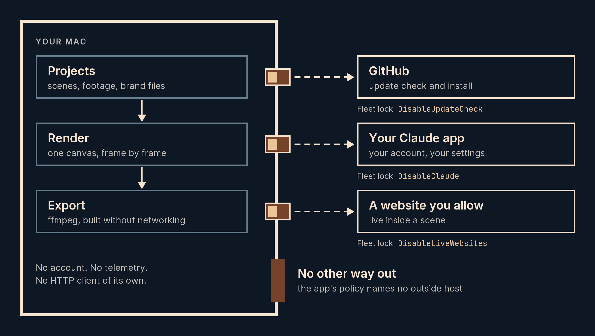
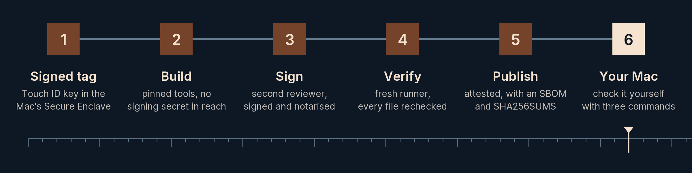

# Security overview

Describes version 0.24.0. For the team deciding whether Kookaburra Cut can run
on managed Macs: the security lead, CTO or engineering manager. Every line
links to the file, command or release asset behind it, and anything not done
yet sits under [Not yet](#not-yet). Read it at the tag of the version you
install (`github.com/michael-palmes/kookaburra-cut/blob/v<version>/docs/security-overview.md`),
where every link resolves to that version's code; a release's assets carry
`SECURITY.md` as it stood at the tag.

The three documents, nothing repeated between them on purpose:

| Document | For | What it holds |
| --- | --- | --- |
| [privacy.md](./privacy.md) | The person using the app | What leaves the Mac, what the app keeps, how to clear it, in plain words |
| This page | The security lead, CTO or engineering manager | The data-flow statement, where data rests, how releases are built, questionnaire answers |
| [SECURITY.md](../SECURITY.md) | The security engineer, auditor and contributor | Every control with the file or command behind it, the threat model, how to report a vulnerability |

The deployment guide for the IT team is [fleet.md](./fleet.md); the keys it
forces are in [mdm.md](./mdm.md). Procurement's long form is
[vendor-questionnaire.md](./vendor-questionnaire.md), and every third party a
Mac can reach is in [subprocessors.md](./subprocessors.md).

## In one paragraph

Kookaburra Cut is a free, open-source macOS desktop app (Tauri 2: a Rust shell
and one WKWebView) that renders product launch films from a folder of scene
code and assets, on the Mac itself. It runs no service, holds no account and
links no HTTP client of its own. Four paths can reach the network, each
started by a person and each with a managed off switch: an opt-in update check
against GitHub and the install it offers, an Edit with Claude handoff to the
Claude desktop app on the same Mac, and a website a person allows inside a
scene. Releases are built by
GitHub Actions from a signed tag, Developer ID signed, notarised and attested,
with a software bill of materials beside each one. One maintainer runs the
project, and the deliberate deferrals are public under
[Not yet](#not-yet).

## What leaves the Mac

Nothing leaves the Mac unless a person starts it
([SECURITY.md, "What leaves the Mac"](../SECURITY.md#what-leaves-the-mac)).



| Path | Trigger | Destination host | What goes | Off switch and control |
| --- | --- | --- | --- | --- |
| Update check | At launch and then hourly while the app is open, at most once every 20 hours, only with the first-run consent on; or Check for Updates by hand | `github.com`, which redirects to `release-assets.githubusercontent.com` | One GET for `latest.json`; no identifiers, no version in the URL | The first-run switch or Settings ▸ Updates; `DisableUpdateCheck` for a fleet, or `UpdateEndpoint` to point it at your own server. `src-tauri/src/updater.rs`, `src/engine/updates.ts` |
| Update install | Install and relaunch on the update dialog | The host `latest.json` names (GitHub's release assets, or your mirror) | The signed updater archive, checked against the ed25519 key built into the app and bound to the announced version before anything is written | Later; `DisableUpdateCheck`. `updater.rs` (`download_and_install`) |
| Edit with Claude | Pressing Edit with Claude, with the Claude desktop app installed | The Claude desktop app on this Mac, which talks to Anthropic under the person's own account | The project folder's path and a starter prompt, typed into that app and never sent until the person presses Enter there | Not pressing it; `DisableClaude` removes the buttons, `DisableAgentKit` removes everything the app lays out for an agent. `src-tauri/src/claude_app.rs` |
| Live scene websites | Allow for that origin in the paused editor; Present reloads an allowed origin on each hold | The approved origin, with the reach of a browser tab | Whatever the page loads; cookies and storage in a profile separate from Safari | Revoke in the inspector; Settings ▸ Website data; `DisableLiveWebsites` or `AllowedWebsiteOrigins`. `src-tauri/src/website.rs` |

Two buttons open a fixed page in the default browser: Get Claude
(`claude.ai/download`) and What leaves your Mac (this repository's
`docs/privacy.md` at the installed version's tag). Each URL is a constant and
nothing is appended to it (`claude_app.rs`, `open_claude_download`,
`open_privacy_page`).

No Rust code links an HTTP client of its own (reqwest arrives only through the
updater plugin, and `src-tauri/deny.toml` bans every other way in); the window's content
security policy allows `connect-src` only to itself, `blob:`, `data:`, `ipc:`
and `asset:` (`src-tauri/tauri.conf.json`, `security.csp`); and the release
ffmpeg is built `--disable-network` (`scripts/build-ffmpeg-sidecar.sh`).
Opening a project, importing a pack, exporting and presenting make no request,
and allowed scene code cannot make one: it runs in a worker that refuses to
start in a release build unless that policy is live. A guard limits every
network API to the app's own files (`src/stage/realmGuard.ts`), but code in the
worker can undo it, so the policy and the window's `asset://` reach are the
bound.

## Subprocessors and third parties

None. The app runs no service and holds no account, so there is no processor
of your data to list. Two third parties can be contacted, each only when a
person acts:

- **GitHub**, for the opt-in update check and the download of a release
  ([What leaves the Mac](#what-leaves-the-mac)). A fleet can point the check at
  its own server instead (`UpdateEndpoint`, [mdm.md](./mdm.md)) or turn it off.
- **Anthropic**, only through the person's own Claude Code install and account,
  and only after they press Edit with Claude or start Claude Code in the folder
  themselves. From there Claude Code sends the project's files to Anthropic as
  the person works, under their account and the organisation's Claude settings,
  which this app does not control
  ([SECURITY.md, "What reaches your agent"](../SECURITY.md#what-reaches-your-agent)).

A website a person allows in a scene is a third party of their own choosing,
reached like a browser tab.

## Where data rests and how to delete it

Every location, with its mode, is in
[SECURITY.md, "On the Mac"](../SECURITY.md#on-the-mac). In short:

- **Projects**: `~/Kookaburra Cut` by default, or the path `WorkspaceRoot`
  forces. Ordinary documents, backed up and indexed like any file. Each project
  is a small git repository holding scenes and settings only; footage and
  exports never enter its history (`src-tauri/src/history.rs`).
- **App data**: `~/Library/Application Support/com.mpalmes.kookaburracut`,
  owner-only (0700 and 0600), re-sealed at every launch, skipped by Spotlight
  (`src-tauri/src/privacy.rs`). It holds `settings.json` (preferences, the
  projects allowed to run, known pack publishers, website grants), `cache/`
  (decoded frames and previews, capped at 20 GB, skipped by Time Machine),
  `pack-key/identity.json` (the public half of the pack key) and `logs/` (the
  activity log, rotated at 1 MiB with three files kept, owner-only, holding
  paths, slugs, origins, key ids and versions, never file contents).
- **The pack signing key**: a generic password in the login Keychain, never
  synchronised; the one secret the app keeps
  ([SECURITY.md, "Saved secrets"](../SECURITY.md#saved-secrets)).
- **Website data**: `~/Library/WebKit/com.mpalmes.kookaburracut`, one WebKit
  store per project, so a sign-in made for one project never shows in another,
  separate from Safari. Settings ▸ Website data lists and clears them. The one
  store every project shared before 0.23.0 is deleted at launch, so people
  sign in to allowed sites again.
- **The agent's files**: the kit the app writes inside each project (`.claude/`,
  `./kb`, `CLAUDE.md`, `.kb/`), and `~/Kookaburra Cut/_bridge` and `_autorun`,
  the file queues the agent and the terminal use, owner-only and pruned (bridge
  responses live at most an hour; kb also keeps its newest film frames and
  export records there, and `kb video` drafts for up to 24 hours). `~/.claude` is Claude Code's own; the app
  never reads or writes it.
- **Exports**: `~/Downloads` by default, or the project's `exports/` folder
  (Settings ▸ Video, or `ExportsInProject` for a fleet). A failed video export
  leaves `<export>.health.json` (the frame and scenes it reached, memory
  samples) in the project's `exports/` until that export next starts.

Encryption at rest is FileVault and the account: the app adds none and claims
none. Deletion while installed: Settings ▸ Allowed projects ▸ Forget removes
one project's grant, its website grants and its Website data; Settings ▸
Storage ▸ Clear all app data removes every cache, every website store, the
bridge's queues and the autorun runs, and resets the settings to the workspace
location and the update consent, keeping the pack key and its Keychain item,
the log and the projects; deleting a project moves it to the Trash and drops
its grant, its website grants, its Website data and its cache entries.

### Uninstall

The same steps as [privacy.md, "Uninstalling"](./privacy.md#uninstalling):

1. Settings ▸ Storage ▸ Clear all app data, while the app is still installed:
   it is the only thing that clears the website profiles.
2. Quit the app.
3. In Keychain Access, delete "Kookaburra Cut pack signing key". Packs it
   signed stay valid.
4. Delete `~/Library/Application Support/com.mpalmes.kookaburracut`,
   `~/Library/WebKit/com.mpalmes.kookaburracut`,
   `~/Library/Caches/com.mpalmes.kookaburracut` (WebKit's own cache) and
   `~/Library/Preferences/com.mpalmes.kookaburracut.plist` (macOS's record of
   the file dialogs' size). `find ~/Library -iname '*kookaburracut*'` lists what
   is there.
5. Delete `~/Kookaburra Cut/_bridge` and `~/Kookaburra Cut/_autorun`. The
   projects are yours; a kept project's kit files (`.claude/`, `./kb`, `.kb/`,
   `CLAUDE.md`) are safe to delete.
6. Delete the app. `~/.claude` belongs to Claude Code.

## Verify it yourself

Every release's page carries the DMG, the MDM pkg, `SHA256SUMS`,
`build-info.txt`, the SBOM, the sidecar's ffmpeg, x264 and x265 source
archives, the provenance bundle (`KookaburraCut-<version>.intoto.jsonl`), the
updater archive's signature (`.tar.gz.sig`) and a copy of `SECURITY.md` at
the tag ([SECURITY.md, "Release integrity"](../SECURITY.md#release-integrity)).
On a Mac with the app installed and the release's files downloaded:

```bash
V=<version>; P=<previous version>
shasum -a 256 -c SHA256SUMS --ignore-missing
for f in "KookaburraCut-$V.dmg" build-info.txt; do
  gh attestation verify "$f" --repo michael-palmes/kookaburra-cut \
    --signer-workflow michael-palmes/kookaburra-cut/.github/workflows/release.yml \
    --source-ref "refs/tags/v$V" --deny-self-hosted-runners
done
gh attestation verify "KookaburraCut-$V.dmg" --bundle "KookaburraCut-$V.intoto.jsonl" \
  --repo michael-palmes/kookaburra-cut \
  --signer-workflow michael-palmes/kookaburra-cut/.github/workflows/release.yml \
  --source-ref "refs/tags/v$V" --deny-self-hosted-runners        # offline, from the release's own bundle
gh attestation verify "KookaburraCut-$V.dmg" --repo michael-palmes/kookaburra-cut \
  --signer-workflow michael-palmes/kookaburra-cut/.github/workflows/release.yml \
  --source-ref "refs/tags/v$V" --deny-self-hosted-runners \
  --predicate-type https://cyclonedx.org/bom                    # the SBOM attestation
grep '^commit=' build-info.txt                                  # the same commit as the next line
git ls-remote https://github.com/michael-palmes/kookaburra-cut "refs/tags/v$V^{}"
codesign -dvv "/Applications/Kookaburra Cut.app"                # flags=0x10000(runtime), Developer ID Application, TeamIdentifier=Q4B8N8ZKA2
codesign -d --entitlements - "/Applications/Kookaburra Cut.app" # none
spctl -a -t exec -vv "/Applications/Kookaburra Cut.app"         # source=Notarized Developer ID
git diff "v$P" "v$V" -- SECURITY.md docs/mdm.md src-tauri/src/managed.rs   # what changed in the controls
```

`scripts/verify-install.sh --version "$V" --dir <downloads> --previous "$P"`
runs the same checks from a checkout, plus the sidecars' signatures and, with
the pkg in the folder, its attestations, installer signature and Gatekeeper.
The Team ID in every signature is `Q4B8N8ZKA2`,
printed in each release's notes and in
[SECURITY.md, "Verify an install"](../SECURITY.md#release-integrity).
`SHA256SUMS` alone catches a broken download; the attestations are the check
that counts, since they tie each file to this repository's release workflow at
that tag on GitHub's own runners.

## What the app does not do

- **No accounts.** No sign-in, no licence key, no registration
  ([privacy.md](./privacy.md)).
- **No telemetry, analytics or crash reporting.** Nothing phones home: the
  content security policy names no outside host and no Rust code links an HTTP
  client ([What leaves the Mac](#what-leaves-the-mac)).
- **Never starts Claude Code, and never holds an API key.** A session begins in
  the Claude desktop app or the person's own terminal, under their own account
  ([SECURITY.md, "What reaches your agent"](../SECURITY.md#what-reaches-your-agent)).
- **No shell**, except the updater's administrator install when the app's
  folder is not writable, behind macOS's own password prompt;
  `DisableUpdateCheck` removes it
  ([SECURITY.md, "On the Mac"](../SECURITY.md#on-the-mac)).
- **No launch agent, login item or helper tool.** Nothing of it runs while the
  app is closed; its only child processes are listed in
  [fleet.md, "What to expect in EDR"](./fleet.md#what-to-expect-in-edr).
- **No remote code.** No plugin store and no scripts fetched at run time; a
  project's scene code runs only after a person presses Allow on a native
  sheet, in a worker shut off from the network and the app's commands
  ([SECURITY.md, "Scene code and the trust boundary"](../SECURITY.md#scene-code-and-the-trust-boundary)).
- **No App Sandbox.** The app runs under the hardened runtime with no
  entitlements and the person's own file access; the reasons are recorded in
  [decisions.md](./decisions.md) and the item is listed under
  [Not yet](#not-yet).

## How releases are built

Each line is one job or control in
[SECURITY.md, "Release integrity"](../SECURITY.md#release-integrity).



1. **A signed tag.** A release is a `v*` tag on `main`, signed with a Touch ID
   key held in a Mac's Secure Enclave; the build job refuses a tag whose key is
   not in `.github/allowed_tag_signers` (`.github/workflows/release.yml`).
2. **Build, with no signing secret in reach,** on a pinned toolchain (Rust,
   Node, pnpm and the sidecar's build tools) from ffmpeg, x264 and x265 sources
   pinned by SHA-256; `build-info.txt` records the runner image, Xcode, commit
   and pins, the binary carries its own Rust dependency list (`cargo auditable`)
   and the job writes the SBOM (`scripts/sbom.mjs`) and the licence texts the
   app carries, failing when they miss anything the SBOM lists
   (`scripts/licence-notices.mjs`).
3. **Sign, in the protected `release` environment** behind a required reviewer
   who did not start the run:
   Developer ID, hardened runtime, no entitlements, notarised and stapled; the
   updater archive signed with ed25519 and bound to the version
   (`scripts/sign-and-notarize.sh`); the MDM pkg built from the stapled app,
   signed with a Developer ID Installer certificate, notarised and stapled.
4. **Verify, on a fresh runner with no secret:** signatures, notarisation,
   Gatekeeper, the updater signature against the key in the app, and every
   file in the signed app against the build job's own record, the pkg's app
   against the zip's byte for byte, and every licence text in both
   (`scripts/verify-release.sh`).
5. **Publish:** `SHA256SUMS`, GitHub build provenance attestations over the
   DMG, pkg, zip, updater archive, `build-info.txt`, the SBOM and the
   sidecar's exact ffmpeg, x264 and x265 source archives, with the
   attestation's bundle and the updater archive's signature published as
   release assets for offline checks, release notes built from `CHANGELOG.md`,
   and a copy of `SECURITY.md` at the tag; a draft a person publishes.
6. **The repository:** every pull request's head commit signed by a listed key;
   CodeQL over JavaScript and TypeScript, Rust, Actions and Python; `cargo deny`
   for advisories, licences, bans and sources and `pnpm audit` on every pull
   request and weekly; dependency review with a severity floor and a licence
   list; Dependabot; every action pinned to a commit SHA
   (`.github/workflows/`).

Two caveats, stated so they are not implied away: one maintainer holds admin
rights, and though a release run needs a second reviewer's approval, an admin
can change that rule, so the pipeline rests on one account (the one sanctioned
change, a break-glass for an urgent security fix, is named in that release's
notes and advisory: [incident-response.md](./incident-response.md)); and no build is claimed reproducible (the runner image
and Xcode float and are recorded), though the exported film is, and the
packaged-parity gate proves that each release
([determinism.md](./determinism.md)).

## On managed Macs

A configuration profile forces keys in the domain `com.mpalmes.kookaburracut`;
the app honours a key only while macOS reports it forced, a user's own
`defaults write` grants nothing, and a malformed key fails closed. The eleven
keys, each with a row, a guard and a test in [mdm.md](./mdm.md):

- `DisableClaude`: removes every Edit with Claude entry point and the Claude
  download link.
- `DisableAgentKit`: stops everything the app lays out for an agent: no kit
  stamped into a project, no bridge folder, no handoff.
- `DisableLiveWebsites`: no live website ever opens in a scene; captured images
  still render.
- `AllowedWebsiteOrigins`: live websites only from these exact origins, and a
  grant made before the profile stops working; an empty list means none.
- `AllowedPublisherKeyIds`: pack imports limited to these publishers' keys; an
  empty list means no imports at all.
- `DisablePackExport`: no Share as pack, and no signing key is ever minted.
- `DisableUpdateCheck`: no update check and no in-app install.
- `UpdateEndpoint`: the in-app check asks your server instead of GitHub; the
  archive must still carry this project's signature.
- `ExportsInProject`: renders land beside their project, never in `~/Downloads`.
- `WorkspaceRoot`: where projects are kept, fixed.
- `AuditLogPath`: a copy of the app log in a folder your collector reads.

`DisableAgentKit`, `DisablePackExport`, `ExportsInProject` and `UpdateEndpoint`
are honoured from 0.22.3; an older build ignores them, so deploy 0.22.3 or
later before relying on them. `AuditLogPath` and `AllowedWebsiteOrigins` need
0.23.0.

The settings the app writes into a project for Claude Code cover only projects
the app has opened; Claude Code's own managed settings sit on top of them.
Recommendations per key, the Claude Code settings, what to expect in EDR and
whether to use the in-app updater or MDM delivery are in
[fleet.md](./fleet.md).

## Reporting a vulnerability

Report privately through GitHub's private vulnerability reporting: the
[report form](https://github.com/michael-palmes/kookaburra-cut/security/advisories/new),
which creates a draft advisory visible only to the maintainer, or email
`security@kookaburracut.com`. You will get an
acknowledgement within 14 days, usually sooner, and a fix or mitigation plan
once the report is confirmed
([SECURITY.md, "Reporting a vulnerability"](../SECURITY.md#reporting-a-vulnerability)).
0.23.0 is the first version recommended for managed Macs; earlier versions
are unsupported. Only the latest release receives security fixes, best effort
with no committed time. Each fix is listed under `### Security` in
[CHANGELOG.md](../CHANGELOG.md) and in the release notes built from it, and
from 0.23.0 on also gets a GitHub security advisory: watch the repository's
releases and [advisories](https://github.com/michael-palmes/kookaburra-cut/security/advisories).
A compromised release or signing key: [incident-response.md](./incident-response.md).

## Questionnaire answers

In the shape of SIG Lite and the CAIQ, one or two sentences each, with the
place to check.

| Question | Answer |
| --- | --- |
| Hosting and data residency | None. The app runs on the Mac it is installed on; there is no server, tenant or region, and your data stays in the person's home folder ([Where data rests](#where-data-rests-and-how-to-delete-it)). |
| Data handled | Whatever a person puts in a project: scene code, footage, stills, brand files, a soundtrack, and the caches derived from them. The app reads nothing outside the project, the workspace and the library folders it serves ([SECURITY.md, "On the Mac"](../SECURITY.md#on-the-mac)). |
| Accounts and authentication | None. No sign-in and no licence key; the Claude integration uses the person's own Claude Code account ([What the app does not do](#what-the-app-does-not-do)). |
| Encryption in transit | The update check and install use HTTPS to GitHub or your `UpdateEndpoint`; a live website must be HTTPS or loopback (`website.rs`). Nothing else leaves ([What leaves the Mac](#what-leaves-the-mac)). |
| Encryption at rest | None by the app: FileVault and the account are the protection at rest. App data is owner-only, 0700 folders and 0600 files, re-sealed each launch (`privacy.rs`). |
| Logging and audit | `~/Library/Application Support/com.mpalmes.kookaburracut/logs/app.log`: trust grants and declines, website grants, pack imports with key id and verdict, update checks and installs, managed refusals; paths, slugs, origins, key ids and versions, never file contents; rotated at 1 MiB with three files kept, owner-only, never sent anywhere ([SECURITY.md, "On the Mac"](../SECURITY.md#on-the-mac)). |
| Retention | Nothing is held by anyone but the Mac. Caches are capped at 20 GB with least-recently-used eviction; bridge responses live an hour, `kb video` drafts and import backups 24 hours; a deleted project goes to the Trash ([fleet.md, "Retention"](./fleet.md#retention)). |
| Deletion | Settings ▸ Allowed projects ▸ Forget, Settings ▸ Storage ▸ Clear all app data, Settings ▸ Website data, and the [uninstall steps](#uninstall). |
| Subprocessors | None ([Subprocessors and third parties](#subprocessors-and-third-parties)). |
| Third parties | GitHub for the update check and downloads; Anthropic through the person's own Claude Code; each only when a person acts. |
| Security contact and response window | GitHub private vulnerability reporting or `security@kookaburracut.com`; an acknowledgement within 14 days, fixes best effort with no committed time ([Reporting a vulnerability](#reporting-a-vulnerability)). |
| Secure development | Every pull request head signed; CodeQL over four languages; `cargo deny` and `pnpm audit` on every pull request and weekly; dependency review with a severity floor; Dependabot; `unsafe` denied crate-wide and allowed per file with a SAFETY line on every block; hostile-input tests over packs, images, fonts and the agent's inputs; a leak check for workspace names; a high-effort code review before every pull request ([SECURITY.md, "Release integrity"](../SECURITY.md#release-integrity) and ["Process"](../SECURITY.md#process)). |
| Signed releases | Yes. Developer ID signed with the hardened runtime and notarised by Apple; a GitHub build provenance attestation per release, with its bundle published as a release asset (`KookaburraCut-<version>.intoto.jsonl`) so it can be checked offline, and the updater archive's ed25519 signature (`.tar.gz.sig`) published beside it ([Verify it yourself](#verify-it-yourself)). |
| Software bill of materials | Yes: a CycloneDX JSON per release (`KookaburraCut-<version>.cdx.json`) covering the Rust and npm dependencies, the ffmpeg, x264 and x265 sources, the beat model and the bundled fonts, HDRIs, device models, shaders and kit scripts by hash, attested on the DMG and the pkg; the binary also carries its Rust dependency list (`cargo auditable`) ([Verify it yourself](#verify-it-yourself)). |
| Penetration test | None. The maintainer's own audit in November 2026 drove the changes from 0.22.0 on; no third-party test has been done. |
| Fuzzing | Yes, for the riskiest parsers: a weekly cargo-fuzz run (`.github/workflows/fuzz.yml`) over pack archive paths, manifests and signatures, the edit documents, font faces, the mp4 `moov` reader and PNG decoding, and every pull request runs each target over its seeds. The other parsers are bounded and tested on hostile fixtures ([Not yet](#not-yet)). |
| Certifications | None: no SOC 2, ISO 27001 or similar. |
| Sandboxing | Scene code runs in a Web Worker with no DOM, no IPC and no network; a live website runs in a child webview with no app capability; the app itself has the hardened runtime, no entitlements and no App Sandbox; the agent is bounded by rules and asks, not a sandbox ([SECURITY.md, "Scene code and the trust boundary"](../SECURITY.md#scene-code-and-the-trust-boundary)). |
| Supported versions | The latest release only; nothing before 0.23.0 is recommended for managed Macs, and each fix from 0.23.0 on gets a GitHub security advisory ([SECURITY.md, "Supported versions"](../SECURITY.md#supported-versions)). |
| Business continuity | One maintainer, no named successor. Installed apps keep working offline if the project stops; the code is MIT or Apache-2.0 and every dependency, tool and source is pinned and recorded, so a fork can build and ship it ([release-cadence.md, "If the project stops"](./release-cadence.md#if-the-project-stops)). |
| Licence | MIT OR Apache-2.0 for the code; bundled assets keep their own terms; the ffmpeg sidecar is a GPL build run as a separate process, its exact source archives attached to each release; every licence text and a third-party notices file ship inside the app (Settings ▸ About ▸ Acknowledgements) ([NOTICE.md](../NOTICE.md)). |
| Egress hosts | `github.com` and `release-assets.githubusercontent.com` (updates, or your `UpdateEndpoint` instead); `claude.ai`, a fixed page a person opens in their browser; the origins a person allows in a scene. Nothing else ([What leaves the Mac](#what-leaves-the-mac)). |
| Fleet controls | Eleven managed keys through a configuration profile ([mdm.md](./mdm.md)); verified builds delivered by MDM; Claude Code's own managed settings ([fleet.md](./fleet.md)). |

## Not yet

Deferred on purpose, listed so nobody mistakes them for done. This is
[SECURITY.md's list](../SECURITY.md#not-yet) for the version above, word for
word:

- Fuzzing beyond the weekly cargo-fuzz run (`.github/workflows/fuzz.yml`:
  pack archive paths, manifests and signatures, the edit documents, SFNT
  faces, the mp4 `moov` reader, PNG decode): `allsorts` shaping, glTF inputs,
  the image facts readers and the `.kbpack` archive reader as a whole are
  bounded and tested on hostile fixtures, not fuzzed.
- An App Sandbox for the app itself: kb's headless CLI is the same binary, the
  updater swaps the bundle in place, and each workspace or linked `assets/`
  root would need a dialog (`docs/decisions.md`, "No App Sandbox").
- A published Homebrew tap: the cask is staged in `packaging/homebrew/` until
  the tap repository `michael-palmes/homebrew-kookaburra-cut` exists.
- Bridge signing against same-user processes. Since 0.23.0 every request and
  answer is signed under the serving instance's key ("What reaches your
  agent"), which closes a writer that can drop files in
  `_bridge` but not read the key: the agent's own file tools, which are denied
  it. It does not close any process running as the user, or a shell command the
  person approves, reading the key and forging both directions; the bash-pre
  check on `_bridge/keys` is best effort. The heartbeat stays unsigned, so a
  forged heartbeat with a planted key is the same case.
- Sealing the trust state: `trustedProjects`, `websiteOriginGrants` and
  `knownPublishers` are plain JSON under the 0600 file mode. An HMAC under a
  Keychain secret can't serve headless exports, and after the stage worker a forged
  grant buys only a sandboxed render; native consent closes the webview path.
- A token on the autorun launch variables: `KOOKABURRA_ACTION` and its set are
  honoured in release builds, which is the same-user case above.
- Confirmation before kb reaches another project: kb can read and write another
  project in the workspace (`-C`, an `@file` path, `--out`) without asking. The
  bridge asks per project; kb's own commands need a rule for what counts as
  another project first.
- A stage guard the worker can't undo: `realmGuard.ts` runs inside the realm it
  guards, so scene code can tamper with the builtins it relies on. Moving the
  check into Rust needs a per-realm token. Until then the bound is the window's
  `asset://` reach.
- One stage worker per project: a worker lives per window role, so the editor
  switching projects, and the render window's captures, reuse one realm. Its
  store writes are limited, but code from one project can still see the next.
- Agent configuration on another branch: Edit with Claude checks `HEAD` and the
  index, so a branch the person checks out later in a session can still bring
  agent files back.
- A sandbox for the agent. Its allow and deny rules, hooks and reach checks bound
  its own tools and ask a person; a script a misled agent runs can still read a
  file.
- `release` environment rules the admin cannot change, a review on `main` the
  admin cannot bypass, and a pinned runner image and Xcode (`build-info.txt`
  records both).
